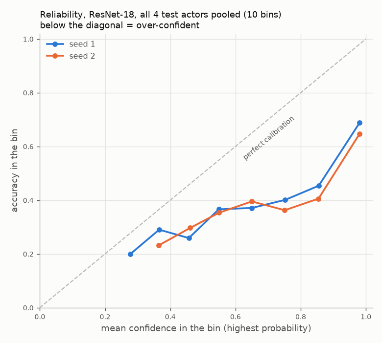
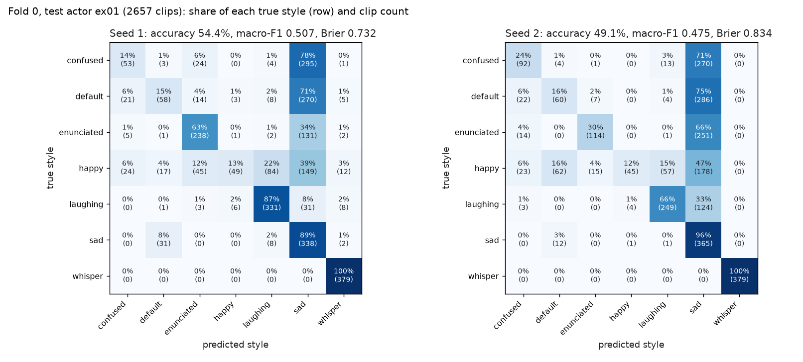
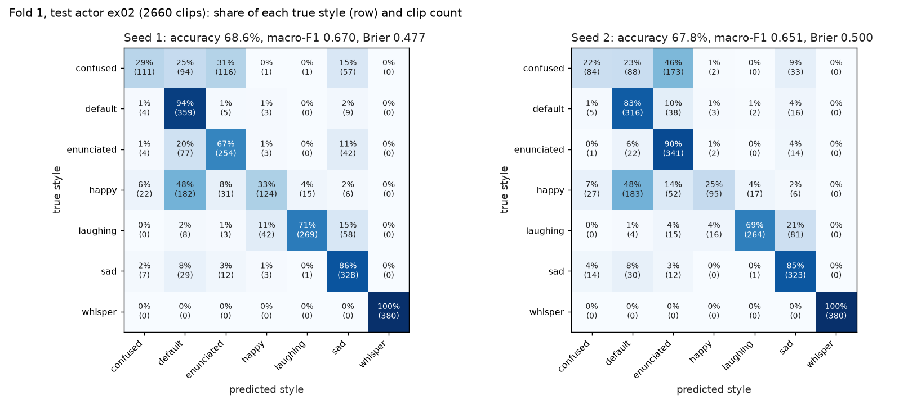
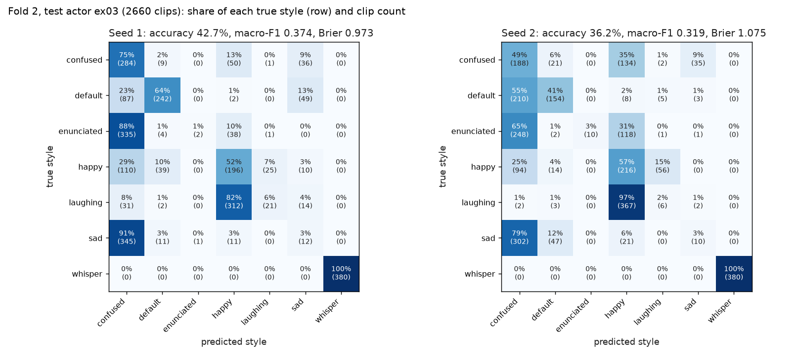
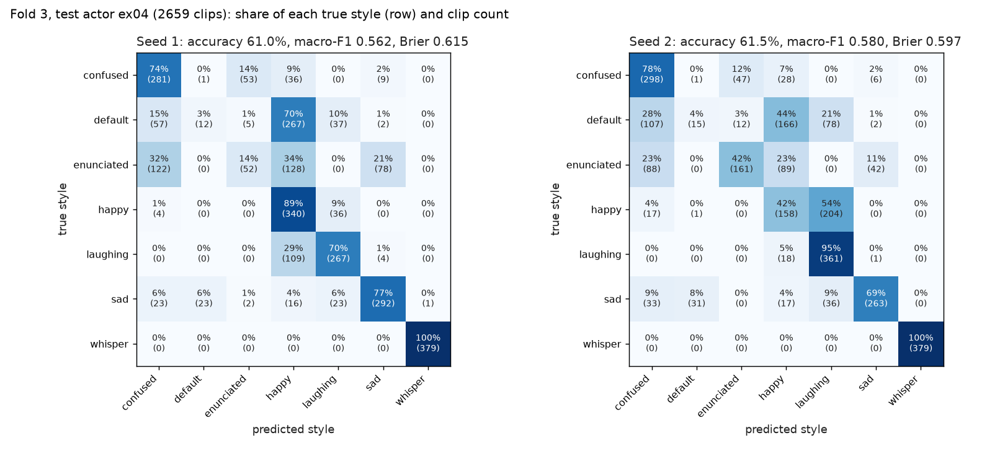

# Calibration of the ResNet-18 (8 baseline runs: 2 seeds x 4 folds)

Saved best checkpoints, each run's test actor, inference exactly as in the original test evaluation (float16 autocast). No retraining, no tuning and **no temperature scaling or other calibration**: these are the model's raw softmax probabilities. Predictions match each run's saved `test_predictions.csv` (100% of clips in every run; largest probability difference 7.8e-07, from the 6-decimal rounding of the saved file).

**Brier score** (same definition as Aung's LR report): mean over clips of the sum over the 7 classes of (p_c - 1[c = true class])^2. 0 = perfect, **uniform guess (1/7 each) = 0.857**, worse than uniform is possible (a confident wrong answer scores up to 2). **Confidence** = the highest predicted probability. Gap = mean confidence - accuracy; a positive gap means over-confident.

## Brier score per test actor

| fold | test actor | Brier seed 1 | Brier seed 2 | Brier, mean of seeds | Aung's LR Brier (same actor) |
|---|---|---|---|---|---|
| 0 | ex01 | 0.732 | 0.834 | 0.783 | 0.604 |
| 1 | ex02 | 0.477 | 0.500 | 0.489 | 0.462 |
| 2 | ex03 | 0.973 | 1.075 | 1.024 | 0.859 |
| 3 | ex04 | 0.615 | 0.597 | 0.606 | 0.495 |
| **mean of the 4 folds** | | **0.699** | **0.752** | **0.725** | **0.605** |

Aung's numbers are from his report of 12 Nov 2026 and are **not checked in this repository**. They are joined on the test actor: his fold k is our fold k-1 (his fold 2 = ex02 = our fold 1). Lower is better.

## Confidence against accuracy per test actor

| fold | test actor | seed | accuracy | mean confidence | gap (conf - acc) | mean conf. when correct | mean conf. when wrong | clips with conf. > 0.9 | accuracy on those |
|---|---|---|---|---|---|---|---|---|---|
| 0 | ex01 | 1 | 54.4% | 85.7% | +31.2 pts | 91.4% | 78.9% | 59.7% | 67.9% |
| 0 | ex01 | 2 | 49.1% | 86.1% | +37.1 pts | 90.0% | 82.4% | 60.3% | 57.7% |
| 1 | ex02 | 1 | 68.6% | 86.0% | +17.4 pts | 90.9% | 75.3% | 59.0% | 83.9% |
| 1 | ex02 | 2 | 67.8% | 86.6% | +18.9 pts | 91.2% | 77.1% | 61.3% | 81.7% |
| 2 | ex03 | 1 | 42.7% | 86.9% | +44.2 pts | 90.0% | 84.6% | 62.1% | 48.6% |
| 2 | ex03 | 2 | 36.2% | 85.9% | +49.6 pts | 87.8% | 84.8% | 57.5% | 39.7% |
| 3 | ex04 | 1 | 61.0% | 86.1% | +25.0 pts | 91.3% | 77.8% | 59.4% | 75.6% |
| 3 | ex04 | 2 | 61.5% | 86.7% | +25.2 pts | 92.7% | 77.0% | 61.5% | 78.0% |
| **mean of folds** | | 1 | 56.7% | 86.2% | +29.5 pts | | | | |
| **mean of folds** | | 2 | 53.6% | 86.3% | +32.7 pts | | | | |

## Reliability (10 bins, all test clips pooled over the 4 actors)

Bins by the highest predicted probability. With 7 classes the highest probability is at least 1/7, so the lowest bin is always empty. Bins with fewer than 20 clips are left out of the plot but kept in the table.

| confidence bin | seed 1: clips | mean conf. | accuracy | seed 2: clips | mean conf. | accuracy |
|---|---|---|---|---|---|---|
| 0.0-0.1 | 0 |  |  | 0 |  |  |
| 0.1-0.2 | 0 |  |  | 0 |  |  |
| 0.2-0.3 | 20 | 27.8% | 20.0% | 6 | 27.9% | 0.0% |
| 0.3-0.4 | 131 | 36.6% | 29.0% | 125 | 36.5% | 23.2% |
| 0.4-0.5 | 425 | 45.7% | 25.9% | 408 | 46.1% | 29.7% |
| 0.5-0.6 | 738 | 54.9% | 36.6% | 733 | 55.0% | 35.3% |
| 0.6-0.7 | 814 | 65.0% | 37.1% | 863 | 65.0% | 39.5% |
| 0.7-0.8 | 903 | 75.2% | 40.1% | 858 | 75.1% | 36.2% |
| 0.8-0.9 | 1217 | 85.5% | 45.4% | 1245 | 85.5% | 40.6% |
| 0.9-1.0 | 6388 | 98.0% | 68.8% | 6398 | 98.1% | 64.7% |

Expected calibration error (summary of the table: sum over bins of share x |accuracy - mean confidence|): seed 1 0.295, seed 2 0.327, both seeds pooled 0.311.

## Test confusion matrices and per-style precision, recall, F1 (CLAUDE.md rule)

From the same predictions as above (identical to `reports/training_all/`). Rows = true style, columns = predicted style; each box the share of its row and the clip count.

### Fold 0 (test actor ex01)

| style | test clips | seed 1 precision | seed 1 recall | seed 1 F1 | seed 2 precision | seed 2 recall | seed 2 F1 |
|---|---|---|---|---|---|---|---|
| confused | 380 | 0.51 | 0.14 | 0.22 | 0.60 | 0.24 | 0.34 |
| default | 379 | 0.52 | 0.15 | 0.24 | 0.43 | 0.16 | 0.23 |
| enunciated | 380 | 0.73 | 0.63 | 0.68 | 0.83 | 0.30 | 0.44 |
| happy | 380 | 0.83 | 0.13 | 0.22 | 0.90 | 0.12 | 0.21 |
| laughing | 380 | 0.76 | 0.87 | 0.81 | 0.77 | 0.66 | 0.71 |
| sad | 379 | 0.28 | 0.89 | 0.42 | 0.25 | 0.96 | 0.39 |
| whisper | 379 | 0.93 | 1.00 | 0.96 | 1.00 | 1.00 | 1.00 |
| **macro average** | 2657 | **0.65** | **0.54** | **0.51** | **0.68** | **0.49** | **0.48** |

### Fold 1 (test actor ex02)

| style | test clips | seed 1 precision | seed 1 recall | seed 1 F1 | seed 2 precision | seed 2 recall | seed 2 F1 |
|---|---|---|---|---|---|---|---|
| confused | 380 | 0.75 | 0.29 | 0.42 | 0.64 | 0.22 | 0.33 |
| default | 380 | 0.48 | 0.94 | 0.64 | 0.49 | 0.83 | 0.62 |
| enunciated | 380 | 0.60 | 0.67 | 0.63 | 0.54 | 0.90 | 0.67 |
| happy | 380 | 0.70 | 0.33 | 0.45 | 0.81 | 0.25 | 0.38 |
| laughing | 380 | 0.94 | 0.71 | 0.81 | 0.93 | 0.69 | 0.80 |
| sad | 380 | 0.66 | 0.86 | 0.75 | 0.68 | 0.85 | 0.76 |
| whisper | 380 | 1.00 | 1.00 | 1.00 | 1.00 | 1.00 | 1.00 |
| **macro average** | 2660 | **0.73** | **0.69** | **0.67** | **0.73** | **0.68** | **0.65** |

### Fold 2 (test actor ex03)

| style | test clips | seed 1 precision | seed 1 recall | seed 1 F1 | seed 2 precision | seed 2 recall | seed 2 F1 |
|---|---|---|---|---|---|---|---|
| confused | 380 | 0.24 | 0.75 | 0.36 | 0.18 | 0.49 | 0.26 |
| default | 380 | 0.79 | 0.64 | 0.70 | 0.64 | 0.41 | 0.50 |
| enunciated | 380 | 0.67 | 0.01 | 0.01 | 1.00 | 0.03 | 0.05 |
| happy | 380 | 0.32 | 0.52 | 0.40 | 0.25 | 0.57 | 0.35 |
| laughing | 380 | 0.44 | 0.06 | 0.10 | 0.09 | 0.02 | 0.03 |
| sad | 380 | 0.10 | 0.03 | 0.05 | 0.20 | 0.03 | 0.05 |
| whisper | 380 | 1.00 | 1.00 | 1.00 | 1.00 | 1.00 | 1.00 |
| **macro average** | 2660 | **0.51** | **0.43** | **0.37** | **0.48** | **0.36** | **0.32** |

### Fold 3 (test actor ex04)

| style | test clips | seed 1 precision | seed 1 recall | seed 1 F1 | seed 2 precision | seed 2 recall | seed 2 F1 |
|---|---|---|---|---|---|---|---|
| confused | 380 | 0.58 | 0.74 | 0.65 | 0.55 | 0.78 | 0.65 |
| default | 380 | 0.33 | 0.03 | 0.06 | 0.31 | 0.04 | 0.07 |
| enunciated | 380 | 0.46 | 0.14 | 0.21 | 0.73 | 0.42 | 0.54 |
| happy | 380 | 0.38 | 0.89 | 0.53 | 0.33 | 0.42 | 0.37 |
| laughing | 380 | 0.74 | 0.70 | 0.72 | 0.53 | 0.95 | 0.68 |
| sad | 380 | 0.76 | 0.77 | 0.76 | 0.84 | 0.69 | 0.76 |
| whisper | 379 | 1.00 | 1.00 | 1.00 | 1.00 | 1.00 | 1.00 |
| **macro average** | 2659 | **0.61** | **0.61** | **0.56** | **0.61** | **0.62** | **0.58** |

Files: `metrics.json` (every number above, per run), `reliability.png`, `confusion_fold{k}.png`.
