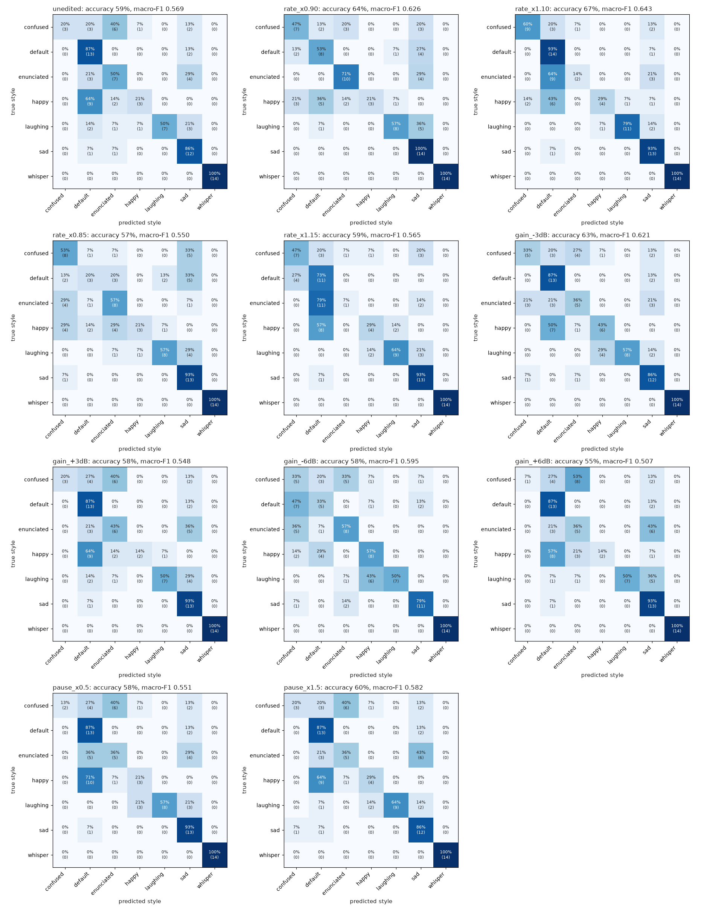

# Counterfactual edits: ResNet-18 (fold 1, seed 1, pretrained), 100 clips of ex02

## Setup

- Model `models/fold1_seed1_pretrained/best.pt`, float32, eval mode, no autocast; the 100 explainer clips (`clips_fold1.csv`, test actor ex02, 59 predicted correctly); fold-1 train-only normalisation. No training.
- Every edit is applied to the **full** 16 kHz clip; then the cache rule (first 4 s, zero padding to 4 s, same log-mel, float16). Checks passed: the rebuilt unedited spectrograms equal the cache bit for bit, and the unedited predictions equal the explainers' saved predictions for all 100 clips. WSOLA at rate 1 returns its input exactly.
- Dials and steps were fixed in `DECISIONS.md` before anything was run and were not changed: speaking rate x0.90, x1.10, x0.85, x1.15 (WSOLA, pitch kept; x0.85 = slower); loudness -3, +3, -6, +6 dB; internal pause length x0.5, x1.5. 'Flip' = the predicted style differs from the unedited prediction.
- Pauses: the same energy rule as the speech/pause labels (250 ms sliding mean of the frame dB below -55.58 dB), internal pauses only. 68 of 100 clips have at least one internal pause (median 1 per clip, median 0.17 s in total); **32 clips have none** and 33 have none inside the 4 s window, so the pause dial leaves them (or their window) unchanged. These clips are counted as 'not flipped'; the tables give how many windows were actually changed.
- Seed 42 for every random draw (listening selection, A/B order, file ids, self-check clips); the edits themselves are deterministic.

## How often each edit changes the label

| edit | windows changed | flipped (of 100) | of correct | of wrong | wrong -> true style | correct -> wrong | median abs. change of p(unedited class) | max | accuracy after |
|---|---|---|---|---|---|---|---|---|---|
| rate_x0.90 | 100 | **26** | 8/59 | 18/41 | 13 | 8 | 0.097 | 0.779 | 64% |
| rate_x1.10 | 100 | **31** | 7/59 | 24/41 | 15 | 7 | 0.104 | 0.830 | 67% |
| rate_x0.85 | 100 | **44** | 15/59 | 29/41 | 13 | 15 | 0.273 | 0.962 | 57% |
| rate_x1.15 | 100 | **34** | 11/59 | 23/41 | 11 | 11 | 0.140 | 0.885 | 59% |
| gain_-3dB | 100 | **13** | 2/59 | 11/41 | 6 | 2 | 0.081 | 0.466 | 63% |
| gain_+3dB | 100 | **5** | 2/59 | 3/41 | 1 | 2 | 0.021 | 0.369 | 58% |
| gain_-6dB | 100 | **35** | 13/59 | 22/41 | 12 | 13 | 0.216 | 0.881 | 58% |
| gain_+6dB | 100 | **12** | 6/59 | 6/41 | 2 | 6 | 0.046 | 0.662 | 55% |
| pause_x0.5 | 67 | **9** | 3/59 | 6/41 | 2 | 3 | 0.007 | 0.555 | 58% |
| pause_x1.5 | 67 | **9** | 3/59 | 6/41 | 4 | 3 | 0.006 | 0.474 | 60% |

Unedited accuracy on these clips: 59%.

**Loudness is not 'almost no effect'** by the fixed rule (+-6 dB must flip fewer than 5 of 100 clips each way with median probability change below 0.05): flips at -3/+3/-6/+6 dB = 13/5/35/12, median changes 0.081/0.021/0.216/0.046.

## Smallest step at which the label changes (per clip and dial)

| dial | flips at the smaller step | only at the larger step | no flip at any step | down only | up only | both directions | non-monotonic (flip at small step, not at large) |
|---|---|---|---|---|---|---|---|
| rate | 42 | 15 | 43 | 18 | 12 | 27 | 6 |
| gain | 17 | 27 | 56 | 32 | 8 | 4 | 1 |
| pause | 13 | n/a (one step) | 87 | 4 | 4 | 5 | 0 |

Pause has one step per direction, so its 'smaller step' is that step.

## Side effect: the edit also changes how much of the 4 s window is padding

Rate and pause edits change the clip's length, so a short clip gains or loses padding (a possible shortcut, see the observations in DECISIONS.md); a long clip keeps a fully real window but shows a different stretch of the sentence. Flips split by that:

| edit | window fully real before and after: flipped / clips | padding amount changed: flipped / clips |
|---|---|---|
| rate_x0.90 | 6 / 26 | 20 / 74 |
| rate_x1.10 | 7 / 18 | 24 / 82 |
| rate_x0.85 | 13 / 26 | 31 / 74 |
| rate_x1.15 | 9 / 16 | 25 / 84 |
| gain_-3dB | 2 / 26 | 0 / 0 |
| gain_+3dB | 0 / 26 | 0 / 0 |
| gain_-6dB | 8 / 26 | 0 / 0 |
| gain_+6dB | 2 / 26 | 0 / 0 |
| pause_x0.5 | 3 / 22 | 6 / 47 |
| pause_x1.5 | 2 / 26 | 7 / 43 |

**Rate artefact control** (x0.85 then x1/0.85, net rate 1): the label changes for **42 of 100** clips (median abs. change of p(unedited class) 0.241). Of the 135 rate flips (clip x step), 97 are on clips that also flip under the round trip, so for those the WSOLA processing alone may be enough to move the label.

Clips with a rate flip at any step: 57; of these, 20 do **not** flip under the round trip.

**What the processing changes (diagnostic added after seeing the round-trip result; medians over the 100 clips, `cf_processing_diagnostic.csv`).** The round trip, compared bin by bin with the unedited window: speech frames -1.00 dB, pause frames -1.89 dB, lowest 32 mel bands -0.93 dB, highest 32 -1.50 dB, mean absolute change per bin 2.44 dB. WSOLA overlap-adds shifted frames, which lowers the level of noise-like parts (room tone, breath, fricatives) and smears fine structure, so the processed clip is also slightly quieter and duller. Overall level change of each edit (mean dB of the window's real frames, edited minus unedited):

| edit | rate_x0.90 | rate_x1.10 | rate_x0.85 | rate_x1.15 | gain_-3dB | gain_+3dB | gain_-6dB | gain_+6dB | pause_x0.5 | pause_x1.5 |
|---|---|---|---|---|---|---|---|---|---|---|
| median dB | -0.85 | -0.26 | -1.11 | -0.23 | -2.98 | +2.99 | -5.95 | +5.98 | +0.72 | -0.65 |

A single rate pass therefore also acts as a small loudness and texture edit, and the model reacts to loudness (gain table above). The rate flips cannot be read as an effect of speaking rate alone.

## Wrong clips: does any single edit give the true style?

**28 of 41** wrong clips reach their true style with at least one of the 8 single edits.

| clip | true style | unedited prediction | edits that give the true style | other labels reached |
|---|---|---|---|---|
| ex02_confused_00034 | confused | happy | rate_x0.90 rate_x1.10 rate_x0.85 | confused default |
| ex02_confused_00057 | confused | enunciated | rate_x1.10 rate_x0.85 rate_x1.15 gain_-3dB gain_-6dB | confused |
| ex02_confused_00111 | confused | sad | - | - |
| ex02_confused_00196 | confused | enunciated | rate_x0.90 rate_x1.10 rate_x0.85 rate_x1.15 | confused |
| ex02_confused_00239 | confused | default | rate_x0.85 | confused |
| ex02_confused_00251 | confused | enunciated | gain_-3dB | confused |
| ex02_confused_00262 | confused | sad | gain_-6dB | confused |
| ex02_confused_00269 | confused | enunciated | rate_x1.10 rate_x0.85 rate_x1.15 | confused |
| ex02_confused_00333 | confused | default | - | - |
| ex02_confused_00356 | confused | enunciated | rate_x0.90 rate_x1.10 | confused sad |
| ex02_confused_00374 | confused | enunciated | rate_x0.90 rate_x1.10 rate_x0.85 rate_x1.15 | confused |
| ex02_confused_00377 | confused | default | - | sad |
| ex02_default_00068 | default | sad | rate_x1.10 rate_x1.15 | default |
| ex02_default_00110 | default | sad | rate_x1.15 | default |
| ex02_enunciated_00096 | enunciated | sad | rate_x0.90 | confused default enunciated |
| ex02_enunciated_00167 | enunciated | sad | rate_x0.85 | confused default enunciated |
| ex02_enunciated_00171 | enunciated | default | rate_x0.90 rate_x0.85 gain_-6dB | enunciated |
| ex02_enunciated_00265 | enunciated | default | rate_x0.90 rate_x0.85 gain_-6dB gain_+6dB | enunciated |
| ex02_enunciated_00299 | enunciated | sad | - | confused default |
| ex02_enunciated_00313 | enunciated | default | rate_x0.90 rate_x0.85 | enunciated |
| ex02_enunciated_00325 | enunciated | sad | gain_-6dB pause_x1.5 | default enunciated |
| ex02_happy_00006 | happy | default | gain_-6dB | happy |
| ex02_happy_00028 | happy | default | gain_-3dB gain_-6dB | happy laughing |
| ex02_happy_00094 | happy | default | - | confused sad |
| ex02_happy_00121 | happy | default | - | confused |
| ex02_happy_00125 | happy | enunciated | - | confused default |
| ex02_happy_00126 | happy | default | - | confused |
| ex02_happy_00213 | happy | default | - | confused enunciated laughing |
| ex02_happy_00219 | happy | enunciated | rate_x1.10 rate_x1.15 gain_-3dB gain_-6dB pause_x1.5 | default happy |
| ex02_happy_00228 | happy | default | - | confused |
| ex02_happy_00265 | happy | default | gain_-6dB | happy |
| ex02_happy_00301 | happy | default | rate_x0.90 rate_x1.10 rate_x0.85 rate_x1.15 gain_-3dB gain_-6dB | happy sad |
| ex02_laughing_00042 | laughing | sad | rate_x1.10 rate_x1.15 gain_-6dB | laughing |
| ex02_laughing_00052 | laughing | sad | - | enunciated happy |
| ex02_laughing_00070 | laughing | enunciated | rate_x0.90 rate_x1.10 rate_x0.85 rate_x1.15 gain_-3dB gain_-6dB pause_x0.5 pause_x1.5 | laughing |
| ex02_laughing_00096 | laughing | happy | - | sad |
| ex02_laughing_00286 | laughing | default | rate_x0.90 rate_x1.10 pause_x1.5 | happy laughing sad |
| ex02_laughing_00297 | laughing | sad | rate_x1.10 | happy laughing |
| ex02_laughing_00326 | laughing | default | - | enunciated happy |
| ex02_sad_00096 | sad | enunciated | rate_x0.90 rate_x1.10 rate_x0.85 rate_x1.15 gain_+3dB gain_+6dB pause_x0.5 | confused sad |
| ex02_sad_00352 | sad | default | rate_x0.90 rate_x1.10 | confused sad |

Wrong clips reaching the true style by dial: rate 22, gain 14, pause 5.

## Per style

Flips by the clip's **true** style (a clip counts once per dial if any step flips it), and reachability as a **target**: how many clips not predicted as that style before are predicted as it after some edit.

| style | clips | flipped by any edit | by rate | by gain | by pause | predicted unedited | reached from other clips | reached by (edit count per dial) | those clips' unedited prediction |
|---|---|---|---|---|---|---|---|---|---|
| confused | 15 | 13 | 9 | 6 | 1 | 3 | **31** | rate:42 gain:23 pause:1 | default:14 enunciated:11 sad:4 happy:2 |
| default | 15 | 14 | 13 | 8 | 0 | 31 | **16** | rate:22 pause:4 gain:3 | sad:7 enunciated:6 happy:2 confused:1 |
| enunciated | 14 | 14 | 14 | 10 | 6 | 17 | **16** | rate:14 gain:9 pause:1 | default:8 sad:5 confused:2 happy:1 |
| happy | 14 | 12 | 10 | 8 | 1 | 5 | **12** | gain:17 rate:10 pause:4 | default:7 sad:2 laughing:2 enunciated:1 |
| laughing | 14 | 10 | 8 | 9 | 4 | 7 | **9** | rate:17 gain:4 pause:3 | default:5 sad:2 enunciated:1 happy:1 |
| sad | 14 | 4 | 3 | 3 | 1 | 23 | **16** | rate:30 gain:9 pause:5 | default:8 enunciated:5 laughing:1 happy:1 confused:1 |
| whisper | 14 | 0 | 0 | 0 | 0 | 14 | **0** | - | - |

**Styles that no edit reaches: whisper.**

Label changes (from unedited prediction to edited prediction), counted over clip x edit:

| dial | from | to | count |
|---|---|---|---|
| gain | default | happy | 11 |
| gain | default | confused | 10 |
| gain | enunciated | confused | 8 |
| gain | enunciated | sad | 5 |
| gain | sad | confused | 5 |
| gain | default | enunciated | 3 |
| gain | sad | enunciated | 3 |
| gain | confused | enunciated | 2 |
| gain | default | sad | 2 |
| gain | enunciated | happy | 2 |
| gain | enunciated | laughing | 2 |
| gain | happy | default | 2 |
| gain | happy | sad | 2 |
| gain | laughing | happy | 2 |
| gain | sad | happy | 2 |
| gain | enunciated | default | 1 |
| gain | happy | enunciated | 1 |
| gain | happy | laughing | 1 |
| gain | sad | laughing | 1 |
| pause | enunciated | sad | 5 |
| pause | default | happy | 2 |
| pause | enunciated | default | 2 |
| pause | enunciated | laughing | 2 |
| pause | confused | default | 1 |
| pause | default | laughing | 1 |
| pause | enunciated | confused | 1 |
| pause | enunciated | happy | 1 |
| pause | sad | default | 1 |
| pause | sad | enunciated | 1 |
| pause | sad | happy | 1 |
| rate | enunciated | confused | 19 |
| rate | default | confused | 17 |
| rate | default | sad | 12 |
| rate | enunciated | sad | 12 |
| rate | sad | default | 12 |
| rate | default | enunciated | 11 |
| rate | default | laughing | 10 |
| rate | enunciated | default | 8 |
| rate | default | happy | 6 |
| rate | enunciated | laughing | 4 |
| rate | happy | confused | 4 |
| rate | happy | sad | 4 |
| rate | sad | laughing | 3 |
| rate | enunciated | happy | 2 |
| rate | happy | default | 2 |
| rate | sad | confused | 2 |
| rate | sad | enunciated | 2 |
| rate | sad | happy | 2 |
| rate | confused | sad | 1 |
| rate | happy | enunciated | 1 |
| rate | laughing | sad | 1 |

## Confusion matrices and per-style metrics: unedited vs each edit (CLAUDE.md rule)

Rows = true style, columns = predicted style; each box the share of its row and the clip count. 100 test clips of ex02 (the explainer subset, not the whole test actor).

**unedited**: accuracy 59%, macro-F1 0.569

| style | clips | precision | recall | F1 |
|---|---|---|---|---|
| confused | 15 | 1.00 | 0.20 | 0.33 |
| default | 15 | 0.42 | 0.87 | 0.57 |
| enunciated | 14 | 0.41 | 0.50 | 0.45 |
| happy | 14 | 0.60 | 0.21 | 0.32 |
| laughing | 14 | 1.00 | 0.50 | 0.67 |
| sad | 14 | 0.52 | 0.86 | 0.65 |
| whisper | 14 | 1.00 | 1.00 | 1.00 |
| **macro average** | 100 | **0.71** | **0.59** | **0.57** |

**rate_x0.90**: accuracy 64%, macro-F1 0.626

| style | clips | precision | recall | F1 |
|---|---|---|---|---|
| confused | 15 | 0.58 | 0.47 | 0.52 |
| default | 15 | 0.50 | 0.53 | 0.52 |
| enunciated | 14 | 0.67 | 0.71 | 0.69 |
| happy | 14 | 1.00 | 0.21 | 0.35 |
| laughing | 14 | 0.80 | 0.57 | 0.67 |
| sad | 14 | 0.47 | 1.00 | 0.64 |
| whisper | 14 | 1.00 | 1.00 | 1.00 |
| **macro average** | 100 | **0.72** | **0.64** | **0.63** |

**rate_x1.10**: accuracy 67%, macro-F1 0.643

| style | clips | precision | recall | F1 |
|---|---|---|---|---|
| confused | 15 | 0.82 | 0.60 | 0.69 |
| default | 15 | 0.42 | 0.93 | 0.58 |
| enunciated | 14 | 0.67 | 0.14 | 0.24 |
| happy | 14 | 0.80 | 0.29 | 0.42 |
| laughing | 14 | 0.92 | 0.79 | 0.85 |
| sad | 14 | 0.59 | 0.93 | 0.72 |
| whisper | 14 | 1.00 | 1.00 | 1.00 |
| **macro average** | 100 | **0.75** | **0.67** | **0.64** |

**rate_x0.85**: accuracy 57%, macro-F1 0.550

| style | clips | precision | recall | F1 |
|---|---|---|---|---|
| confused | 15 | 0.42 | 0.53 | 0.47 |
| default | 15 | 0.43 | 0.20 | 0.27 |
| enunciated | 14 | 0.47 | 0.57 | 0.52 |
| happy | 14 | 0.75 | 0.21 | 0.33 |
| laughing | 14 | 0.73 | 0.57 | 0.64 |
| sad | 14 | 0.46 | 0.93 | 0.62 |
| whisper | 14 | 1.00 | 1.00 | 1.00 |
| **macro average** | 100 | **0.61** | **0.57** | **0.55** |

**rate_x1.15**: accuracy 59%, macro-F1 0.565

| style | clips | precision | recall | F1 |
|---|---|---|---|---|
| confused | 15 | 0.64 | 0.47 | 0.54 |
| default | 15 | 0.32 | 0.73 | 0.45 |
| enunciated | 14 | 0.50 | 0.07 | 0.12 |
| happy | 14 | 0.57 | 0.29 | 0.38 |
| laughing | 14 | 0.82 | 0.64 | 0.72 |
| sad | 14 | 0.62 | 0.93 | 0.74 |
| whisper | 14 | 1.00 | 1.00 | 1.00 |
| **macro average** | 100 | **0.64** | **0.59** | **0.57** |

**gain_-3dB**: accuracy 63%, macro-F1 0.621

| style | clips | precision | recall | F1 |
|---|---|---|---|---|
| confused | 15 | 0.56 | 0.33 | 0.42 |
| default | 15 | 0.50 | 0.87 | 0.63 |
| enunciated | 14 | 0.45 | 0.36 | 0.40 |
| happy | 14 | 0.55 | 0.43 | 0.48 |
| laughing | 14 | 1.00 | 0.57 | 0.73 |
| sad | 14 | 0.57 | 0.86 | 0.69 |
| whisper | 14 | 1.00 | 1.00 | 1.00 |
| **macro average** | 100 | **0.66** | **0.63** | **0.62** |

**gain_+3dB**: accuracy 58%, macro-F1 0.548

| style | clips | precision | recall | F1 |
|---|---|---|---|---|
| confused | 15 | 1.00 | 0.20 | 0.33 |
| default | 15 | 0.41 | 0.87 | 0.55 |
| enunciated | 14 | 0.40 | 0.43 | 0.41 |
| happy | 14 | 1.00 | 0.14 | 0.25 |
| laughing | 14 | 0.88 | 0.50 | 0.64 |
| sad | 14 | 0.50 | 0.93 | 0.65 |
| whisper | 14 | 1.00 | 1.00 | 1.00 |
| **macro average** | 100 | **0.74** | **0.58** | **0.55** |

**gain_-6dB**: accuracy 58%, macro-F1 0.595

| style | clips | precision | recall | F1 |
|---|---|---|---|---|
| confused | 15 | 0.25 | 0.33 | 0.29 |
| default | 15 | 0.38 | 0.33 | 0.36 |
| enunciated | 14 | 0.50 | 0.57 | 0.53 |
| happy | 14 | 0.50 | 0.57 | 0.53 |
| laughing | 14 | 1.00 | 0.50 | 0.67 |
| sad | 14 | 0.79 | 0.79 | 0.79 |
| whisper | 14 | 1.00 | 1.00 | 1.00 |
| **macro average** | 100 | **0.63** | **0.59** | **0.59** |

**gain_+6dB**: accuracy 55%, macro-F1 0.507

| style | clips | precision | recall | F1 |
|---|---|---|---|---|
| confused | 15 | 1.00 | 0.07 | 0.12 |
| default | 15 | 0.43 | 0.87 | 0.58 |
| enunciated | 14 | 0.29 | 0.36 | 0.32 |
| happy | 14 | 1.00 | 0.14 | 0.25 |
| laughing | 14 | 1.00 | 0.50 | 0.67 |
| sad | 14 | 0.45 | 0.93 | 0.60 |
| whisper | 14 | 1.00 | 1.00 | 1.00 |
| **macro average** | 100 | **0.74** | **0.55** | **0.51** |

**pause_x0.5**: accuracy 58%, macro-F1 0.551

| style | clips | precision | recall | F1 |
|---|---|---|---|---|
| confused | 15 | 1.00 | 0.13 | 0.24 |
| default | 15 | 0.39 | 0.87 | 0.54 |
| enunciated | 14 | 0.42 | 0.36 | 0.38 |
| happy | 14 | 0.43 | 0.21 | 0.29 |
| laughing | 14 | 1.00 | 0.57 | 0.73 |
| sad | 14 | 0.54 | 0.93 | 0.68 |
| whisper | 14 | 1.00 | 1.00 | 1.00 |
| **macro average** | 100 | **0.68** | **0.58** | **0.55** |

**pause_x1.5**: accuracy 60%, macro-F1 0.582

| style | clips | precision | recall | F1 |
|---|---|---|---|---|
| confused | 15 | 0.75 | 0.20 | 0.32 |
| default | 15 | 0.43 | 0.87 | 0.58 |
| enunciated | 14 | 0.42 | 0.36 | 0.38 |
| happy | 14 | 0.57 | 0.29 | 0.38 |
| laughing | 14 | 1.00 | 0.64 | 0.78 |
| sad | 14 | 0.50 | 0.86 | 0.63 |
| whisper | 14 | 1.00 | 1.00 | 1.00 |
| **macro average** | 100 | **0.67** | **0.60** | **0.58** |

## Every clip, every dial, every step (predicted style)

Columns in order of step size per dial; **bold** = differs from the unedited prediction. conf = confused, def = default, enun = enunciated, hap = happy, laugh = laughing, whis = whisper.

| clip | true | unedited | rate_x0.90 | rate_x1.10 | rate_x0.85 | rate_x1.15 | gain_-3dB | gain_+3dB | gain_-6dB | gain_+6dB | pause_x0.5 | pause_x1.5 | smallest flip: rate / gain / pause |
|---|---|---|---|---|---|---|---|---|---|---|---|---|---|
| confused_00034 | conf | hap | **conf** | **conf** | **conf** | hap | hap | **def** | hap | **def** | hap | hap | rate_x0.90 / rate_x1.10 / gain_+3dB / none |
| confused_00057 | conf | enun | enun | **conf** | **conf** | **conf** | **conf** | enun | **conf** | enun | enun | enun | rate_x1.10 / gain_-3dB / none |
| confused_00111 | conf | sad | sad | sad | sad | sad | sad | sad | sad | sad | sad | sad | none / none / none |
| confused_00115 | conf | conf | conf | conf | **sad** | conf | conf | conf | conf | conf | conf | conf | rate_x0.85 / none / none |
| confused_00119 | conf | conf | conf | conf | conf | conf | conf | conf | conf | **enun** | **def** | conf | none / gain_+6dB / pause_x0.5 |
| confused_00196 | conf | enun | **conf** | **conf** | **conf** | **conf** | enun | enun | enun | enun | enun | enun | rate_x0.90 / rate_x1.10 / none / none |
| confused_00239 | conf | def | def | def | **conf** | def | def | def | def | def | def | def | rate_x0.85 / none / none |
| confused_00246 | conf | conf | conf | conf | conf | conf | conf | conf | conf | **enun** | conf | conf | none / gain_+6dB / none |
| confused_00251 | conf | enun | enun | enun | enun | enun | **conf** | enun | enun | enun | enun | enun | none / gain_-3dB / none |
| confused_00262 | conf | sad | sad | sad | sad | sad | sad | sad | **conf** | sad | sad | sad | none / gain_-6dB / none |
| confused_00269 | conf | enun | enun | **conf** | **conf** | **conf** | enun | enun | enun | enun | enun | enun | rate_x1.10 / none / none |
| confused_00333 | conf | def | def | def | def | def | def | def | def | def | def | def | none / none / none |
| confused_00356 | conf | enun | **conf** | **conf** | **sad** | **sad** | enun | enun | enun | enun | enun | enun | rate_x0.90 / rate_x1.10 / none / none |
| confused_00374 | conf | enun | **conf** | **conf** | **conf** | **conf** | enun | enun | enun | enun | enun | enun | rate_x0.90 / rate_x1.10 / none / none |
| confused_00377 | conf | def | **sad** | def | **sad** | def | def | def | def | def | def | def | rate_x0.90 / none / none |
| default_00040 | def | def | def | def | **laugh** | def | def | def | def | def | def | def | rate_x0.85 / none / none |
| default_00055 | def | def | **conf** | def | **conf** | **conf** | def | def | **conf** | def | def | def | rate_x0.90 / gain_-6dB / none |
| default_00068 | def | sad | sad | **def** | sad | **def** | sad | sad | sad | sad | sad | sad | rate_x1.10 / none / none |
| default_00079 | def | def | def | def | def | def | def | def | **conf** | def | def | def | none / gain_-6dB / none |
| default_00098 | def | def | **conf** | def | **conf** | **conf** | def | def | **conf** | def | def | def | rate_x0.90 / gain_-6dB / none |
| default_00104 | def | def | def | def | **enun** | def | def | def | **conf** | def | def | def | rate_x0.85 / gain_-6dB / none |
| default_00110 | def | sad | sad | sad | sad | **def** | sad | sad | sad | sad | sad | sad | rate_x1.15 / none / none |
| default_00148 | def | def | **sad** | def | **sad** | **conf** | def | def | **conf** | def | def | def | rate_x0.90 / gain_-6dB / none |
| default_00171 | def | def | def | def | def | def | def | def | def | def | def | def | none / none / none |
| default_00265 | def | def | def | def | **enun** | def | def | def | def | def | def | def | rate_x0.85 / none / none |
| default_00284 | def | def | **laugh** | def | **laugh** | def | def | def | **hap** | def | def | def | rate_x0.90 / gain_-6dB / none |
| default_00327 | def | def | def | def | **enun** | def | def | def | **conf** | def | def | def | rate_x0.85 / gain_-6dB / none |
| default_00351 | def | def | **sad** | def | **sad** | def | def | def | def | def | def | def | rate_x0.90 / none / none |
| default_00362 | def | def | def | def | def | **conf** | def | def | **conf** | def | def | def | rate_x1.15 / gain_-6dB / none |
| default_00379 | def | def | def | def | **sad** | def | def | def | def | def | def | def | rate_x0.85 / none / none |
| enunciated_00096 | enun | sad | **enun** | **def** | **conf** | **def** | **conf** | sad | **conf** | sad | sad | sad | rate_x0.90 / rate_x1.10 / gain_-3dB / none |
| enunciated_00110 | enun | enun | enun | **sad** | enun | **sad** | enun | enun | enun | enun | enun | **sad** | rate_x1.10 / none / pause_x1.5 |
| enunciated_00141 | enun | enun | enun | **def** | enun | **def** | **conf** | enun | **conf** | enun | enun | enun | rate_x1.10 / gain_-3dB / none |
| enunciated_00162 | enun | enun | **sad** | **sad** | **conf** | **sad** | **conf** | **sad** | **conf** | **sad** | **sad** | **sad** | rate_x0.90 / rate_x1.10 / gain_-3dB / gain_+3dB / pause_x0.5 / pause_x1.5 |
| enunciated_00167 | enun | sad | sad | sad | **enun** | **def** | sad | sad | **conf** | sad | sad | sad | rate_x0.85 / rate_x1.15 / gain_-6dB / none |
| enunciated_00171 | enun | def | **enun** | def | **enun** | def | def | def | **enun** | def | def | def | rate_x0.90 / gain_-6dB / none |
| enunciated_00182 | enun | enun | enun | **def** | **conf** | **def** | enun | enun | enun | enun | enun | enun | rate_x1.10 / none / none |
| enunciated_00265 | enun | def | **enun** | def | **enun** | def | def | def | **enun** | **enun** | def | def | rate_x0.90 / gain_-6dB / gain_+6dB / none |
| enunciated_00299 | enun | sad | sad | **def** | **conf** | **def** | sad | sad | **conf** | sad | **def** | sad | rate_x1.10 / gain_-6dB / pause_x0.5 |
| enunciated_00313 | enun | def | **enun** | def | **enun** | def | def | def | def | def | def | def | rate_x0.90 / none / none |
| enunciated_00318 | enun | enun | enun | **def** | enun | **def** | enun | enun | enun | **def** | **def** | enun | rate_x1.10 / gain_+6dB / pause_x0.5 |
| enunciated_00325 | enun | sad | sad | **def** | **def** | **def** | sad | sad | **enun** | sad | sad | **enun** | rate_x1.10 / gain_-6dB / pause_x1.5 |
| enunciated_00346 | enun | enun | enun | enun | **sad** | enun | enun | enun | enun | **sad** | enun | **sad** | rate_x0.85 / gain_+6dB / pause_x1.5 |
| enunciated_00358 | enun | enun | enun | enun | enun | **def** | enun | enun | enun | enun | enun | enun | rate_x1.15 / none / none |
| happy_00006 | hap | def | def | def | def | def | def | def | **hap** | def | def | def | none / gain_-6dB / none |
| happy_00028 | hap | def | def | **laugh** | **laugh** | **laugh** | **hap** | def | **hap** | def | def | def | rate_x1.10 / gain_-3dB / none |
| happy_00094 | hap | def | **conf** | **sad** | **conf** | def | def | def | **conf** | def | def | def | rate_x0.90 / rate_x1.10 / gain_-6dB / none |
| happy_00121 | hap | def | def | def | **conf** | def | def | def | def | def | def | def | rate_x0.85 / none / none |
| happy_00125 | hap | enun | enun | **conf** | enun | **def** | enun | enun | **conf** | enun | enun | enun | rate_x1.10 / gain_-6dB / none |
| happy_00126 | hap | def | **conf** | def | **conf** | def | def | def | def | def | def | def | rate_x0.90 / none / none |
| happy_00160 | hap | hap | **conf** | **def** | **enun** | **def** | hap | **laugh** | hap | **enun** | hap | hap | rate_x0.90 / rate_x1.10 / gain_+3dB / none |
| happy_00200 | hap | hap | hap | hap | hap | hap | hap | hap | hap | hap | hap | hap | none / none / none |
| happy_00213 | hap | def | **laugh** | **conf** | **enun** | **laugh** | def | def | def | def | def | def | rate_x0.90 / rate_x1.10 / none / none |
| happy_00219 | hap | enun | enun | **hap** | enun | **hap** | **hap** | enun | **hap** | enun | **def** | **hap** | rate_x1.10 / gain_-3dB / pause_x0.5 / pause_x1.5 |
| happy_00228 | hap | def | def | def | **conf** | def | def | def | def | def | def | def | rate_x0.85 / none / none |
| happy_00265 | hap | def | def | def | def | def | def | def | **hap** | def | def | def | none / gain_-6dB / none |
| happy_00301 | hap | def | **hap** | **hap** | **hap** | **hap** | **hap** | def | **hap** | **sad** | def | def | rate_x0.90 / rate_x1.10 / gain_-3dB / none |
| happy_00320 | hap | hap | hap | hap | hap | hap | hap | hap | hap | hap | hap | hap | none / none / none |
| laughing_00042 | laugh | sad | sad | **laugh** | sad | **laugh** | sad | sad | **laugh** | sad | sad | sad | rate_x1.10 / gain_-6dB / none |
| laughing_00043 | laugh | laugh | **sad** | laugh | laugh | laugh | laugh | laugh | laugh | laugh | laugh | laugh | rate_x0.90 / none / none |
| laughing_00052 | laugh | sad | sad | sad | **hap** | **hap** | sad | sad | **enun** | sad | sad | sad | rate_x0.85 / rate_x1.15 / gain_-6dB / none |
| laughing_00057 | laugh | laugh | laugh | laugh | laugh | laugh | laugh | laugh | laugh | laugh | laugh | laugh | none / none / none |
| laughing_00070 | laugh | enun | **laugh** | **laugh** | **laugh** | **laugh** | **laugh** | enun | **laugh** | enun | **laugh** | **laugh** | rate_x0.90 / rate_x1.10 / gain_-3dB / pause_x0.5 / pause_x1.5 |
| laughing_00096 | laugh | hap | **sad** | **sad** | **sad** | **sad** | hap | **sad** | hap | **sad** | hap | hap | rate_x0.90 / rate_x1.10 / gain_+3dB / none |
| laughing_00159 | laugh | laugh | laugh | laugh | laugh | laugh | laugh | laugh | laugh | laugh | laugh | laugh | none / none / none |
| laughing_00255 | laugh | laugh | laugh | laugh | laugh | laugh | laugh | laugh | **hap** | laugh | laugh | laugh | none / gain_-6dB / none |
| laughing_00286 | laugh | def | **laugh** | **laugh** | **sad** | **sad** | **hap** | def | **hap** | **sad** | **hap** | **laugh** | rate_x0.90 / rate_x1.10 / gain_-3dB / pause_x0.5 / pause_x1.5 |
| laughing_00297 | laugh | sad | sad | **laugh** | sad | sad | **hap** | sad | **hap** | sad | sad | **hap** | rate_x1.10 / gain_-3dB / pause_x1.5 |
| laughing_00306 | laugh | laugh | laugh | laugh | laugh | laugh | laugh | laugh | laugh | laugh | laugh | laugh | none / none / none |
| laughing_00314 | laugh | laugh | laugh | laugh | laugh | laugh | laugh | laugh | laugh | laugh | laugh | laugh | none / none / none |
| laughing_00322 | laugh | laugh | laugh | laugh | laugh | laugh | laugh | laugh | **hap** | laugh | laugh | laugh | none / gain_-6dB / none |
| laughing_00326 | laugh | def | def | **hap** | **enun** | **hap** | **hap** | def | **hap** | def | **hap** | def | rate_x1.10 / gain_-3dB / pause_x0.5 |
| sad_00016 | sad | sad | sad | sad | sad | sad | sad | sad | sad | sad | sad | sad | none / none / none |
| sad_00029 | sad | sad | sad | sad | sad | sad | sad | sad | sad | sad | sad | sad | none / none / none |
| sad_00062 | sad | sad | sad | sad | sad | sad | sad | sad | sad | sad | sad | sad | none / none / none |
| sad_00096 | sad | enun | **sad** | **sad** | **sad** | **sad** | enun | **sad** | enun | **sad** | **sad** | **conf** | rate_x0.90 / rate_x1.10 / gain_+3dB / pause_x0.5 / pause_x1.5 |
| sad_00105 | sad | sad | sad | sad | sad | sad | sad | sad | sad | sad | sad | sad | none / none / none |
| sad_00150 | sad | sad | sad | **def** | sad | sad | sad | sad | sad | sad | sad | sad | rate_x1.10 / none / none |
| sad_00219 | sad | sad | sad | sad | sad | sad | sad | sad | **enun** | sad | sad | sad | none / gain_-6dB / none |
| sad_00260 | sad | sad | sad | sad | sad | sad | sad | sad | sad | sad | sad | sad | none / none / none |
| sad_00297 | sad | sad | sad | sad | sad | sad | sad | sad | sad | sad | sad | sad | none / none / none |
| sad_00311 | sad | sad | sad | sad | sad | sad | sad | sad | sad | sad | sad | sad | none / none / none |
| sad_00337 | sad | sad | sad | sad | sad | sad | sad | sad | sad | sad | sad | sad | none / none / none |
| sad_00344 | sad | sad | sad | sad | sad | sad | sad | sad | sad | sad | sad | sad | none / none / none |
| sad_00352 | sad | def | **sad** | **sad** | **conf** | def | **conf** | def | **conf** | def | def | def | rate_x0.90 / rate_x1.10 / gain_-3dB / none |
| sad_00360 | sad | sad | sad | sad | sad | sad | sad | sad | sad | sad | sad | sad | none / none / none |
| whisper_00006 | whis | whis | whis | whis | whis | whis | whis | whis | whis | whis | whis | whis | none / none / none |
| whisper_00054 | whis | whis | whis | whis | whis | whis | whis | whis | whis | whis | whis | whis | none / none / none |
| whisper_00061 | whis | whis | whis | whis | whis | whis | whis | whis | whis | whis | whis | whis | none / none / none |
| whisper_00100 | whis | whis | whis | whis | whis | whis | whis | whis | whis | whis | whis | whis | none / none / none |
| whisper_00131 | whis | whis | whis | whis | whis | whis | whis | whis | whis | whis | whis | whis | none / none / none |
| whisper_00170 | whis | whis | whis | whis | whis | whis | whis | whis | whis | whis | whis | whis | none / none / none |
| whisper_00179 | whis | whis | whis | whis | whis | whis | whis | whis | whis | whis | whis | whis | none / none / none |
| whisper_00184 | whis | whis | whis | whis | whis | whis | whis | whis | whis | whis | whis | whis | none / none / none |
| whisper_00185 | whis | whis | whis | whis | whis | whis | whis | whis | whis | whis | whis | whis | none / none / none |
| whisper_00201 | whis | whis | whis | whis | whis | whis | whis | whis | whis | whis | whis | whis | none / none / none |
| whisper_00202 | whis | whis | whis | whis | whis | whis | whis | whis | whis | whis | whis | whis | none / none / none |
| whisper_00246 | whis | whis | whis | whis | whis | whis | whis | whis | whis | whis | whis | whis | none / none / none |
| whisper_00361 | whis | whis | whis | whis | whis | whis | whis | whis | whis | whis | whis | whis | none / none / none |
| whisper_00362 | whis | whis | whis | whis | whis | whis | whis | whis | whis | whis | whis | whis | none / none / none |

## Listening-test material and self-check clips

- `listening/`: 20 pairs (unedited and edited window of the same clip, 20 different clips), 10 where the model's label flipped and 10 where it did not; dials rate 8, pause 6, gain 6. Random pair order, random A/B order, random 8-hex file ids (seed 42). Files: `audio/*.wav` (not in git), `instructions_for_listeners.md`, `answer_sheet_template.csv` (hear a difference? style of A and B), `listening_key.csv` (**not for listeners**: which file is edited, the edit, the model's labels).
- Scoring: `python -m src.explain.score_listening <filled sheets> [--out scores.json]` (main score: the listener's style changes between A and B exactly when the model's label flipped).
- `self_check/` (not in git): 6 edited clips next to their unedited window, one per editing method at its largest step, to judge the editing quality by ear (`self_check_clips.csv`):

| edit | clip | model unedited -> edited |
|---|---|---|
| rate_x0.85 | ex02_sad_00105 | sad -> sad |
| rate_x1.15 | ex02_default_00148 | default -> confused |
| pause_x0.5 | ex02_enunciated_00182 | enunciated -> enunciated |
| pause_x1.5 | ex02_laughing_00052 | sad -> sad |
| gain_-6dB | ex02_whisper_00006 | whisper -> whisper |
| gain_+6dB | ex02_confused_00246 | confused -> enunciated |

## Limits

- 100 clips of one actor (ex02), one model (fold 1, seed 1); small counts per style (about 14).
- An edit is never perfectly isolated: rate and pause edits change how much of the sentence and of the padding sits in the 4 s window (table above); WSOLA also lowers the level and changes the texture, and its round trip alone flips many labels (control above), so the rate dial is confounded with processing; pause edits add crossfades inside pauses. A flip shows the model is sensitive to the edited audio, not that it 'uses speaking rate' as a listener would.
- Speaking rate is changed uniformly over the clip (including pauses); a real slower reading would not stretch everything equally.
- The pause dial only touches internal pauses long and quiet enough to pass the 250 ms energy rule; 32 clips have none and are unchanged. Leading and trailing silence are never edited.
- Loudness: the model input is not clipped (float), so +6 dB is an exact shift of the log-mel; a real louder recording would also change voice quality.
- Only single edits and only the fixed steps; combinations and larger ranges were not tried (by design).
- Whether listeners hear the same change is the separate listening test (`listening/`), not measured here.
