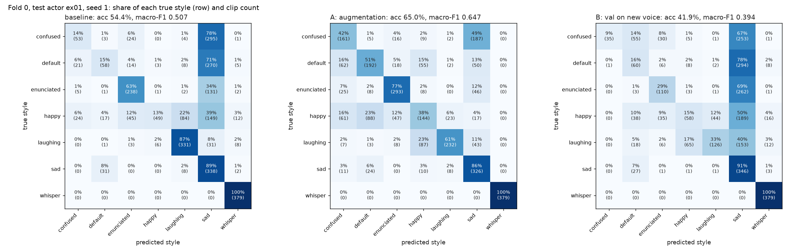
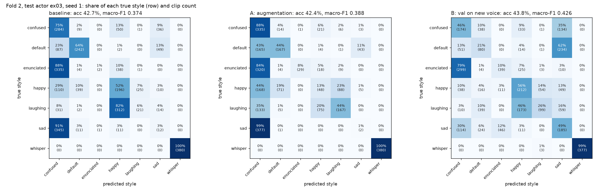

# Training changes compared with the baseline (ResNet-18 pretrained, seed 1)

Baseline: `configs/train.yaml`. Change A: training-only augmentation on the log-mel (`configs/train_aug.yaml`). Change B: one training actor held out completely as the validation set, early stopping and checkpoint choice on its macro-F1 (`configs/train_valactor.yaml`). Everything else is identical. Each run used its test actor once, with the checkpoint chosen on validation; nothing was chosen with the test set. One seed per setting.

## Summary (test set)

| fold (test actor) | run | accuracy | macro-F1 | recall confused | recall default | recall enunciated | recall happy | recall laughing | recall sad | recall whisper |
|---|---|---|---|---|---|---|---|---|---|---|
| 0 (ex01) | baseline | 54.4% | 0.507 | 0.14 | 0.15 | 0.63 | 0.13 | 0.87 | 0.89 | 1.00 |
| 0 (ex01) | A: augmentation | 65.0% | 0.647 | 0.42 | 0.51 | 0.77 | 0.38 | 0.61 | 0.86 | 1.00 |
| 0 (ex01) | B: val on new voice | 41.9% | 0.394 | 0.09 | 0.16 | 0.29 | 0.15 | 0.33 | 0.91 | 1.00 |
| 2 (ex03) | baseline | 42.7% | 0.374 | 0.75 | 0.64 | 0.01 | 0.52 | 0.06 | 0.03 | 1.00 |
| 2 (ex03) | A: augmentation | 42.4% | 0.388 | 0.88 | 0.44 | 0.08 | 0.13 | 0.44 | 0.01 | 1.00 |
| 2 (ex03) | B: val on new voice | 43.8% | 0.426 | 0.46 | 0.21 | 0.10 | 0.56 | 0.26 | 0.49 | 0.99 |

## Runs

| fold | run | folder | config | train actors (clips) | val (clips) | epochs (best) | best val macro-F1 | minutes |
|---|---|---|---|---|---|---|---|---|
| 0 | baseline | `models/fold0_seed1_pretrained` | `configs/train.yaml` | ex02, ex03, ex04 (6383) | same 3 actors, 20% (1596) | 28 (22) | 0.994 | 12.9 |
| 0 | A: augmentation | `models/fold0_seed1_aug` | `configs/train_aug.yaml` | ex02, ex03, ex04 (6383) | same 3 actors, 20% (1596) | 30 (24) | 0.989 | 15.1 |
| 0 | B: val on new voice | `models/fold0_seed1_valactor` | `configs/train_valactor.yaml` | ex03, ex04 (5319) | ex02, all clips (2660) | 13 (7) | 0.615 | 4.9 |
| 2 | baseline | `models/fold2_seed1_pretrained` | `configs/train.yaml` | ex01, ex02, ex04 (6381) | same 3 actors, 20% (1595) | 19 (13) | 0.988 | 8.7 |
| 2 | A: augmentation | `models/fold2_seed1_aug` | `configs/train_aug.yaml` | ex01, ex02, ex04 (6381) | same 3 actors, 20% (1595) | 30 (29) | 0.982 | 15.1 |
| 2 | B: val on new voice | `models/fold2_seed1_valactor` | `configs/train_valactor.yaml` | ex01, ex02 (5317) | ex04, all clips (2659) | 9 (3) | 0.685 | 3.4 |

## Test confusion matrices and per-style precision, recall, F1

Rows = true style, columns = predicted style; each box shows the share of its row and the clip count.

### Fold 0 (test actor ex01)

P = precision, R = recall, F1 = F1 score; baseline / A / B.

| style | test clips | baseline P | baseline R | baseline F1 | A P | A R | A F1 | B P | B R | B F1 |
|---|---|---|---|---|---|---|---|---|---|---|
| confused | 380 | 0.51 | 0.14 | 0.22 | 0.49 | 0.42 | 0.46 | 0.97 | 0.09 | 0.17 |
| default | 379 | 0.52 | 0.15 | 0.24 | 0.60 | 0.51 | 0.55 | 0.30 | 0.16 | 0.21 |
| enunciated | 380 | 0.73 | 0.63 | 0.68 | 0.77 | 0.77 | 0.77 | 0.59 | 0.29 | 0.39 |
| happy | 380 | 0.83 | 0.13 | 0.22 | 0.46 | 0.38 | 0.42 | 0.41 | 0.15 | 0.22 |
| laughing | 380 | 0.76 | 0.87 | 0.81 | 0.87 | 0.61 | 0.72 | 0.72 | 0.33 | 0.45 |
| sad | 379 | 0.28 | 0.89 | 0.42 | 0.49 | 0.86 | 0.62 | 0.23 | 0.91 | 0.37 |
| whisper | 379 | 0.93 | 1.00 | 0.96 | 1.00 | 1.00 | 1.00 | 0.90 | 1.00 | 0.95 |
| **macro average** | 2657 | **0.65** | **0.54** | **0.51** | **0.67** | **0.65** | **0.65** | **0.59** | **0.42** | **0.39** |

### Fold 2 (test actor ex03)

P = precision, R = recall, F1 = F1 score; baseline / A / B.

| style | test clips | baseline P | baseline R | baseline F1 | A P | A R | A F1 | B P | B R | B F1 |
|---|---|---|---|---|---|---|---|---|---|---|
| confused | 380 | 0.24 | 0.75 | 0.36 | 0.22 | 0.88 | 0.36 | 0.25 | 0.46 | 0.33 |
| default | 380 | 0.79 | 0.64 | 0.70 | 0.64 | 0.44 | 0.52 | 0.40 | 0.21 | 0.28 |
| enunciated | 380 | 0.67 | 0.01 | 0.01 | 0.97 | 0.08 | 0.14 | 0.41 | 0.10 | 0.16 |
| happy | 380 | 0.32 | 0.52 | 0.40 | 0.29 | 0.13 | 0.18 | 0.45 | 0.56 | 0.50 |
| laughing | 380 | 0.44 | 0.06 | 0.10 | 0.62 | 0.44 | 0.51 | 0.61 | 0.26 | 0.37 |
| sad | 380 | 0.10 | 0.03 | 0.05 | 0.04 | 0.01 | 0.01 | 0.28 | 0.49 | 0.35 |
| whisper | 380 | 1.00 | 1.00 | 1.00 | 1.00 | 1.00 | 1.00 | 1.00 | 0.99 | 1.00 |
| **macro average** | 2660 | **0.51** | **0.43** | **0.37** | **0.54** | **0.42** | **0.39** | **0.49** | **0.44** | **0.43** |

## Notes

- **One seed per setting.** In the baseline, the two seeds of the same fold differ by 5.3 points of
  accuracy (fold 0) and 6.5 points (fold 2). A difference smaller than that is not clear evidence.
- **A (augmentation) helped on fold 0 and did not help on fold 2.** Fold 0: 54.4% -> 65.0% accuracy,
  macro-F1 0.507 -> 0.647, larger than the seed-to-seed spread; recall rose for confused, default,
  enunciated and happy, fell for laughing (0.87 -> 0.61). Fold 2: 42.7% -> 42.4% accuracy, macro-F1
  0.374 -> 0.388, i.e. no real change; errors moved between styles (laughing recall 0.06 -> 0.44,
  happy 0.52 -> 0.13), enunciated and sad stay near 0.
- **A had not finished improving.** Both A runs used all 30 epochs; on fold 2 the best validation
  epoch was 29. Augmented training learns more slowly, so 30 epochs may be too few for it.
- **B (validation on a new voice) did not help.** Fold 0: 54.4% -> 41.9% accuracy, macro-F1 0.507 ->
  0.394 (worse). Fold 2: 42.7% -> 43.8%, macro-F1 0.374 -> 0.426 (slightly better, within the seed
  spread). Sad recall on fold 2 rose from 0.03 to 0.49, but overall the change is not a clear gain.
- **B stopped very early** (best epoch 7 on fold 0, 3 on fold 2): validation macro-F1 on the held-out
  actor peaks after a few epochs and then falls while training on the other two voices keeps improving.
- **B changes two things at once.** Besides the validation set, the model trains on only 2 voices
  (about 5,320 clips) instead of 3 (about 6,380). Part of the fold 0 loss may come from that.
- **B's validation score is a much better guide to the test score.** Best validation macro-F1 was
  0.615 (fold 0) and 0.685 (fold 2) versus about 0.99 for the baseline and A, whose validation set
  contains the training voices. Test macro-F1 was 0.394 and 0.426, so B's validation is still too
  optimistic, but far less than the baseline's.
