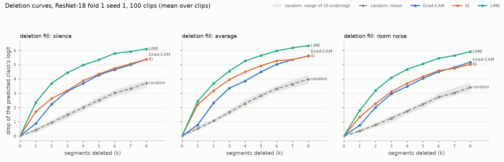
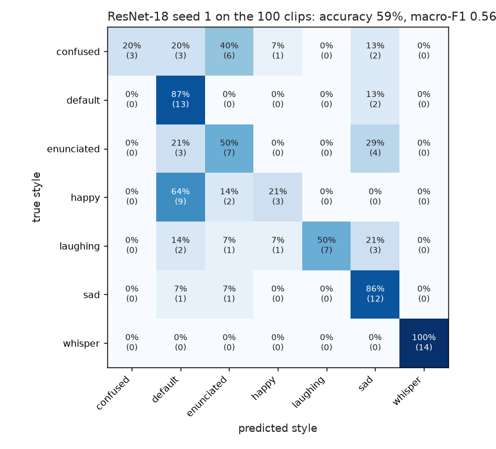

# Deletion curves: ResNet-18 (fold 1, seed 1, pretrained), 100 clips

## What the curve measures

We delete the k real segments an explanation ranks highest (k = 1 to 8, never more than the clip's real segments) by writing a fill into all 128 x 25 values of each, and track how much the logit (and the probability) of the predicted class falls. **The curve measures how much the model relies on that segment being present in its normal form, not what the segment contains:** a deleted segment also becomes a pause (silence, room noise or an average-sound block), so a drop can come from the content going away *or* from the new pause itself (for example a changed amount of speech in the window). A faithful ranking should make the logit fall faster than random orderings that use the same fill.

**Caveat when comparing methods:** LIME was fitted on exactly this kind of perturbation (real segments switched off with the same fill, effect on the same logit), so the deletion test is close to what LIME optimises; IG (gradients along a path to the filled clip) and Grad-CAM (layer4 activations, no fill) are not. A higher LIME area is expected for that reason and is not by itself proof that LIME is more faithful in general. Grad-CAM uses one ranking for all three fills.

## Setup

- Clips: the same 100 fold-1 test clips (`clips_fold1.csv`); 10 have fewer than 8 real segments, so their curves stop earlier (clips per k: k=1: 100, k=2: 100, k=3: 100, k=4: 100, k=5: 100, k=6: 99, k=7: 94, k=8: 90).
- Orderings: the saved segment scores (`resnet_segment_scores.csv`), highest first, real segments only. Random control: 10 random orderings of each clip's real segments, the same 10 for every fill.
- Fills: IG and LIME are deleted with the fill they were computed with; Grad-CAM has no fill and is deleted with all 3. Fill values (fold-1 train clips): room noise -78.23 dB, average -45.74 dB, silence -100.00 dB.
- Area = mean drop over k = 1..K per clip (K = min(8, real segments)), then averaged over clips. *Minus random* = the clip's area minus the mean area of its 10 random orderings; 95% interval by bootstrap over clips. *Beats random* = share of clips where that difference is positive.

## Area under the deletion curve: All 100 clips (n = 100)

| deletion fill | method (scores) | logit drop: area | minus random [95% CI] | beats random | probability drop: area | minus random [95% CI] |
|---|---|---|---|---|---|---|
| silence | Grad-CAM | 3.62 | +1.45 [+1.18, +1.73] | 86% | 0.473 | +0.139 [+0.100, +0.179] |
| silence | IG | 3.83 | +1.67 [+1.39, +1.94] | 87% | 0.518 | +0.184 [+0.149, +0.219] |
| silence | LIME | 4.80 | +2.63 [+2.41, +2.87] | 100% | 0.594 | +0.260 [+0.228, +0.291] |
| silence | random (10 orderings) | 2.16 (sd over orderings 0.11; 1.97 to 2.29) | | | 0.334 (sd 0.016; 0.309 to 0.354) | |
| average | Grad-CAM | 3.81 | +1.41 [+1.21, +1.62] | 92% | 0.493 | +0.188 [+0.154, +0.223] |
| average | IG | 4.35 | +1.95 [+1.73, +2.17] | 97% | 0.564 | +0.259 [+0.221, +0.296] |
| average | LIME | 4.97 | +2.57 [+2.35, +2.81] | 100% | 0.614 | +0.309 [+0.272, +0.344] |
| average | random (10 orderings) | 2.40 (sd over orderings 0.09; 2.26 to 2.51) | | | 0.305 (sd 0.018; 0.269 to 0.323) | |
| room noise | Grad-CAM | 3.43 | +1.50 [+1.28, +1.72] | 95% | 0.462 | +0.187 [+0.150, +0.223] |
| room noise | IG | 3.58 | +1.66 [+1.42, +1.91] | 94% | 0.488 | +0.214 [+0.178, +0.251] |
| room noise | LIME | 4.44 | +2.51 [+2.30, +2.72] | 100% | 0.577 | +0.303 [+0.270, +0.337] |
| room noise | random (10 orderings) | 1.92 (sd over orderings 0.09; 1.74 to 2.05) | | | 0.274 (sd 0.020; 0.229 to 0.295) | |

## Area under the deletion curve: Correct predictions (n = 59)

| deletion fill | method (scores) | logit drop: area | minus random [95% CI] | beats random | probability drop: area | minus random [95% CI] |
|---|---|---|---|---|---|---|
| silence | Grad-CAM | 4.07 | +1.37 [+1.00, +1.74] | 83% | 0.471 | +0.124 [+0.070, +0.183] |
| silence | IG | 4.28 | +1.57 [+1.24, +1.93] | 85% | 0.540 | +0.193 [+0.146, +0.242] |
| silence | LIME | 5.27 | +2.57 [+2.29, +2.86] | 100% | 0.596 | +0.249 [+0.209, +0.292] |
| silence | random (10 orderings) | 2.70 (sd over orderings 0.14; 2.45 to 2.92) | | | 0.347 (sd 0.025; 0.310 to 0.383) | |
| average | Grad-CAM | 4.24 | +1.35 [+1.09, +1.64] | 90% | 0.483 | +0.187 [+0.141, +0.233] |
| average | IG | 4.74 | +1.86 [+1.59, +2.14] | 95% | 0.544 | +0.248 [+0.197, +0.301] |
| average | LIME | 5.34 | +2.46 [+2.18, +2.76] | 100% | 0.600 | +0.304 [+0.253, +0.356] |
| average | random (10 orderings) | 2.88 (sd over orderings 0.15; 2.65 to 3.06) | | | 0.296 (sd 0.027; 0.252 to 0.334) | |
| room noise | Grad-CAM | 3.84 | +1.51 [+1.22, +1.79] | 97% | 0.449 | +0.182 [+0.135, +0.231] |
| room noise | IG | 4.07 | +1.74 [+1.45, +2.04] | 97% | 0.489 | +0.222 [+0.175, +0.269] |
| room noise | LIME | 4.86 | +2.52 [+2.26, +2.81] | 100% | 0.566 | +0.299 [+0.250, +0.346] |
| room noise | random (10 orderings) | 2.33 (sd over orderings 0.10; 2.13 to 2.47) | | | 0.267 (sd 0.021; 0.234 to 0.301) | |

## Area under the deletion curve: Wrong predictions (n = 41)

| deletion fill | method (scores) | logit drop: area | minus random [95% CI] | beats random | probability drop: area | minus random [95% CI] |
|---|---|---|---|---|---|---|
| silence | Grad-CAM | 2.96 | +1.57 [+1.13, +2.02] | 90% | 0.477 | +0.162 [+0.105, +0.222] |
| silence | IG | 3.19 | +1.80 [+1.36, +2.26] | 90% | 0.486 | +0.172 [+0.121, +0.224] |
| silence | LIME | 4.11 | +2.72 [+2.37, +3.11] | 100% | 0.592 | +0.277 [+0.232, +0.326] |
| silence | random (10 orderings) | 1.39 (sd over orderings 0.26; 0.85 to 1.77) | | | 0.315 (sd 0.035; 0.262 to 0.384) | |
| average | Grad-CAM | 3.20 | +1.50 [+1.18, +1.81] | 95% | 0.507 | +0.190 [+0.135, +0.242] |
| average | IG | 3.79 | +2.09 [+1.76, +2.46] | 100% | 0.593 | +0.275 [+0.227, +0.325] |
| average | LIME | 4.43 | +2.73 [+2.39, +3.10] | 100% | 0.634 | +0.317 [+0.271, +0.362] |
| average | random (10 orderings) | 1.70 (sd over orderings 0.20; 1.40 to 2.05) | | | 0.318 (sd 0.046; 0.254 to 0.411) | |
| room noise | Grad-CAM | 2.84 | +1.50 [+1.19, +1.81] | 93% | 0.480 | +0.195 [+0.144, +0.245] |
| room noise | IG | 2.88 | +1.54 [+1.10, +2.00] | 90% | 0.486 | +0.202 [+0.142, +0.255] |
| room noise | LIME | 3.84 | +2.50 [+2.16, +2.86] | 100% | 0.593 | +0.308 [+0.266, +0.350] |
| room noise | random (10 orderings) | 1.33 (sd over orderings 0.20; 0.87 to 1.59) | | | 0.285 (sd 0.041; 0.194 to 0.357) | |

## Mean curve (logit drop by k, all clips)

| deletion fill | method | k=1 | k=2 | k=3 | k=4 | k=5 | k=6 | k=7 | k=8 |
|---|---|---|---|---|---|---|---|---|---|
| silence | Grad-CAM | 0.88 | 2.23 | 3.14 | 3.68 | 4.27 | 4.65 | 4.98 | 5.37 |
| silence | IG | 1.71 | 2.62 | 3.19 | 3.87 | 4.34 | 4.74 | 5.06 | 5.37 |
| silence | LIME | 2.35 | 3.69 | 4.43 | 4.97 | 5.34 | 5.79 | 5.91 | 6.10 |
| silence | random | 0.42 | 0.94 | 1.48 | 1.99 | 2.51 | 3.02 | 3.31 | 3.71 |
| average | Grad-CAM | 0.78 | 2.31 | 3.35 | 3.85 | 4.49 | 5.02 | 5.34 | 5.61 |
| average | IG | 2.20 | 3.17 | 3.95 | 4.49 | 4.92 | 5.27 | 5.35 | 5.60 |
| average | LIME | 2.44 | 3.68 | 4.55 | 5.25 | 5.63 | 5.96 | 6.18 | 6.33 |
| average | random | 0.53 | 1.06 | 1.66 | 2.28 | 2.83 | 3.31 | 3.63 | 3.98 |
| room noise | Grad-CAM | 0.75 | 2.00 | 2.95 | 3.47 | 4.03 | 4.50 | 4.81 | 5.17 |
| room noise | IG | 1.33 | 2.26 | 3.10 | 3.69 | 4.16 | 4.58 | 4.74 | 5.02 |
| room noise | LIME | 1.79 | 3.19 | 4.08 | 4.67 | 5.05 | 5.44 | 5.63 | 5.90 |
| room noise | random | 0.36 | 0.78 | 1.23 | 1.73 | 2.22 | 2.72 | 3.01 | 3.42 |

From k = 6 on, the mean covers fewer clips (see Setup).

## Are the segments deleted first speech or pause?

Share of deleted segments that are speech (energy label: `mean_db` >= -55.58 dB). For random orderings this is the base rate of the clips' real segments.

| deletion fill | method | first deleted (k=1): all | correct | wrong | first 3 deleted: all | correct | wrong |
|---|---|---|---|---|---|---|---|
| silence | Grad-CAM | 92% | 90% | 95% | 77% | 79% | 74% |
| silence | IG | 58% | 66% | 46% | 74% | 77% | 68% |
| silence | LIME | 51% | 63% | 34% | 70% | 77% | 59% |
| silence | random (10 orderings) | 72% | 72% | 72% | 72% | 71% | 72% |
| average | Grad-CAM | 92% | 90% | 95% | 77% | 79% | 74% |
| average | IG | 40% | 44% | 34% | 68% | 69% | 65% |
| average | LIME | 43% | 53% | 29% | 69% | 75% | 60% |
| average | random (10 orderings) | 72% | 72% | 72% | 72% | 71% | 72% |
| room noise | Grad-CAM | 92% | 90% | 95% | 77% | 79% | 74% |
| room noise | IG | 53% | 59% | 44% | 74% | 76% | 70% |
| room noise | LIME | 58% | 61% | 54% | 74% | 76% | 71% |
| room noise | random (10 orderings) | 72% | 72% | 72% | 72% | 71% | 72% |

## ResNet-18 on these 100 clips (CLAUDE.md rule)

Accuracy 59.0%, macro-F1 0.569. Rows = true style, columns = predicted style; each box the share of its row and the clip count.

| style | clips | precision | recall | F1 |
|---|---|---|---|---|
| confused | 15 | 1.00 | 0.20 | 0.33 |
| default | 15 | 0.42 | 0.87 | 0.57 |
| enunciated | 14 | 0.41 | 0.50 | 0.45 |
| happy | 14 | 0.60 | 0.21 | 0.32 |
| laughing | 14 | 1.00 | 0.50 | 0.67 |
| sad | 14 | 0.52 | 0.86 | 0.65 |
| whisper | 14 | 1.00 | 1.00 | 1.00 |
| **macro average** | 100 | **0.71** | **0.59** | **0.57** |

Files: `deletion_curves.csv` (every clip x ordering x fill x k, with the deleted segment, its energy label, logit and probability drop, and whether the prediction still holds), `deletion_metrics.json`.
