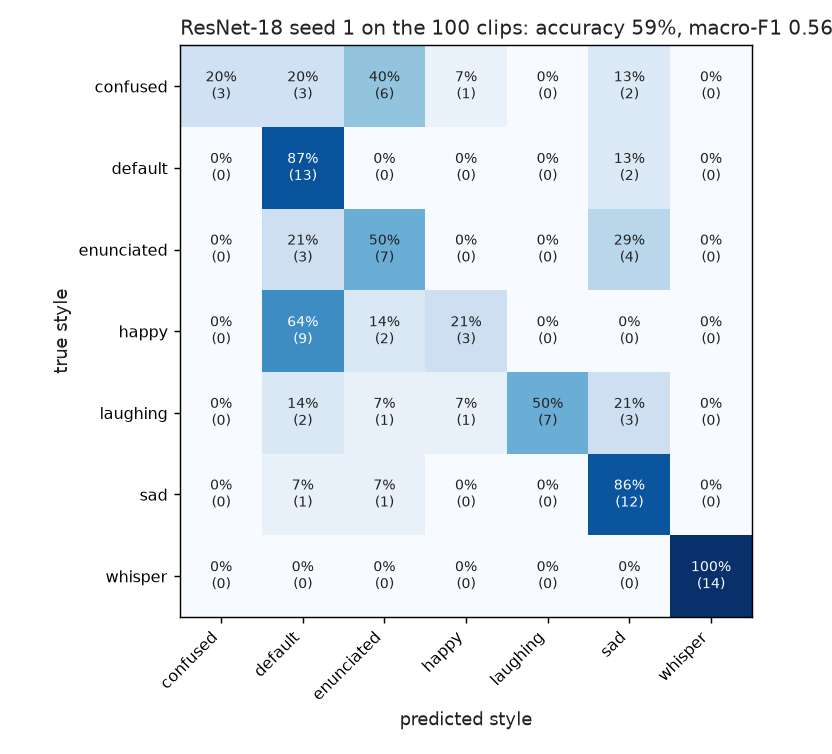

# Explaining the ResNet-18 (fold 1, seed 1, pretrained): Grad-CAM, IG and LIME on 100 clips

## Setup

- **Model:** `models/fold1_seed1_pretrained/best.pt`, float32, eval mode. Its float32 predictions match the saved (mixed-precision) test run for 100% of the clips.
- **Clips:** the same 100 fold-1 test clips (ex02) as the white-box check (`clips_fold1.csv`).
- **Explained quantity:** the logit of the ResNet's predicted class.
- **Same explainer code as the white-box check** (`src/explain/`). IG: 50 steps, baseline = every real segment filled. LIME: 500 samples, the real segments are the features, off = filled. Fills: room noise -78.23 dB, average -45.74 dB, silence -100.00 dB (fold-1 train clips).
- **Grad-CAM:** layer4, no fill. Its map is 4 x 13 (mel x time), upsampled bilinearly to 128 x 400 and summed per segment, so its time resolution (about 0.31 s) is coarser than a segment. Grad-CAM keeps only positive evidence (ReLU). Clips where Grad-CAM is zero on every real segment: 0.
- **Ranking:** real segments only, by signed score (highest = most support for the prediction).
- **Energy label:** a real segment is *speech* if its `mean_db` (segments.csv, mean over bands and its real frames) is at least -55.58 dB, else *pause*. The threshold is Otsu's threshold on the real segments of the fold-1 training clips (their histogram has a low pause/room hump around -85 to -60 dB and a speech peak around -45 to -35 dB).

## Checks

### IG completeness (sum of attributions vs logit(x) - logit(fill)), per clip in `resnet_ig_completeness.csv`

| fill | mean abs logit(x) - logit(fill) | mean abs gap | max abs gap | median relative gap | max relative gap |
|---|---|---|---|---|---|
| silence | 5.75 | 0.041 | 0.140 | 0.6% | 4.6% |
| average | 5.80 | 0.035 | 0.129 | 0.5% | 4.3% |
| room noise | 5.60 | 0.037 | 0.125 | 0.6% | 6.5% |

### Our IG vs Captum `IntegratedGradients` (riemann_middle, 50 steps), 10 clips x 3 fills

Kendall's tau of the 16 segment scores (real segments): mean 1.0000, min 1.0000; same top segment in 100% of cases; largest absolute difference of a segment score 9.8e-03. Captum is used only for this check (`resnet_ig_vs_captum.csv`).

LIME surrogate fit (weighted R2, mean over clips): silence 0.725, average 0.870, room noise 0.777. Lower than on LRfS (0.9997) because the ResNet is not linear in the segments.

## Agreement between methods

Share of the 100 clips where the two explanations have the **same top segment**:

| | Grad-CAM | IG silence | IG average | IG room noise | LIME silence | LIME average | LIME room noise |
|---|---|---|---|---|---|---|---|
| Grad-CAM | 100% | 21% | 13% | 22% | 18% | 17% | 24% |
| IG silence | 21% | 100% | 49% | 74% | 49% | 46% | 43% |
| IG average | 13% | 49% | 100% | 57% | 54% | 59% | 52% |
| IG room noise | 22% | 74% | 57% | 100% | 50% | 48% | 48% |
| LIME silence | 18% | 49% | 54% | 50% | 100% | 73% | 69% |
| LIME average | 17% | 46% | 59% | 48% | 73% | 100% | 67% |
| LIME room noise | 24% | 43% | 52% | 48% | 69% | 67% | 100% |

Mean **top-3 overlap** (share of shared segments among the top 3):

| | Grad-CAM | IG silence | IG average | IG room noise | LIME silence | LIME average | LIME room noise |
|---|---|---|---|---|---|---|---|
| Grad-CAM | 1.00 | 0.42 | 0.44 | 0.46 | 0.52 | 0.49 | 0.51 |
| IG silence | 0.42 | 1.00 | 0.56 | 0.72 | 0.45 | 0.51 | 0.49 |
| IG average | 0.44 | 0.56 | 1.00 | 0.69 | 0.51 | 0.60 | 0.56 |
| IG room noise | 0.46 | 0.72 | 0.69 | 1.00 | 0.52 | 0.59 | 0.56 |
| LIME silence | 0.52 | 0.45 | 0.51 | 0.52 | 1.00 | 0.72 | 0.74 |
| LIME average | 0.49 | 0.51 | 0.60 | 0.59 | 0.72 | 1.00 | 0.76 |
| LIME room noise | 0.51 | 0.49 | 0.56 | 0.56 | 0.74 | 0.76 | 1.00 |

## Speech or pause in the top-3 segments

Base rate: 72% of the real segments of these clips are speech (73% in the 59 correctly classified clips, 72% in the 41 wrong ones). A share above the base rate means the method favours speech; below, pauses.

| explanation | top-3 segments that are speech | in correct clips | in wrong clips | top-1 segment is speech |
|---|---|---|---|---|
| Grad-CAM | 77% | 79% | 74% | 92% |
| IG silence | 74% | 77% | 68% | 58% |
| IG average | 68% | 69% | 65% | 40% |
| IG room noise | 74% | 76% | 70% | 53% |
| LIME silence | 70% | 77% | 59% | 51% |
| LIME average | 69% | 75% | 60% | 43% |
| LIME room noise | 74% | 76% | 71% | 58% |

## Where is the top-1 segment?

For each explanation, the position of its top-1 real segment: the **first** real segment, the **last** real segment (the one next to the padding, or the window end for clips that fill all 4 s), or in **between**, and whether it is speech or pause. The last row is the expected share for a segment drawn at random from each clip's real segments. A large *last, pause* share would point at the clip end, i.e. a length cue. Note that the last real segment is often only partly real (its remaining frames are padding), which also lowers its `mean_db`.

**All 100 clips** (n = 100)

| explanation | first, speech | first, pause | between, speech | between, pause | last, speech | last, pause |
|---|---|---|---|---|---|---|
| Grad-CAM | 0% | 2% | 92% | 5% | 0% | 1% |
| IG silence | 0% | 39% | 58% | 2% | 0% | 1% |
| IG average | 6% | 55% | 34% | 2% | 0% | 3% |
| IG room noise | 0% | 44% | 53% | 2% | 0% | 1% |
| LIME silence | 1% | 46% | 50% | 2% | 0% | 1% |
| LIME average | 3% | 52% | 40% | 4% | 0% | 1% |
| LIME room noise | 1% | 39% | 57% | 3% | 0% | 0% |
| random real segment | 1% | 8% | 69% | 13% | 1% | 8% |

**Correct predictions** (n = 59)

| explanation | first, speech | first, pause | between, speech | between, pause | last, speech | last, pause |
|---|---|---|---|---|---|---|
| Grad-CAM | 0% | 2% | 90% | 7% | 0% | 2% |
| IG silence | 0% | 29% | 66% | 3% | 0% | 2% |
| IG average | 10% | 49% | 34% | 2% | 0% | 5% |
| IG room noise | 0% | 36% | 59% | 3% | 0% | 2% |
| LIME silence | 2% | 36% | 61% | 2% | 0% | 0% |
| LIME average | 5% | 42% | 47% | 3% | 0% | 2% |
| LIME room noise | 2% | 37% | 59% | 2% | 0% | 0% |
| random real segment | 1% | 8% | 69% | 13% | 1% | 8% |

**Wrong predictions** (n = 41)

| explanation | first, speech | first, pause | between, speech | between, pause | last, speech | last, pause |
|---|---|---|---|---|---|---|
| Grad-CAM | 0% | 2% | 95% | 2% | 0% | 0% |
| IG silence | 0% | 54% | 46% | 0% | 0% | 0% |
| IG average | 0% | 63% | 34% | 2% | 0% | 0% |
| IG room noise | 0% | 56% | 44% | 0% | 0% | 0% |
| LIME silence | 0% | 61% | 34% | 2% | 0% | 2% |
| LIME average | 0% | 66% | 29% | 5% | 0% | 0% |
| LIME room noise | 0% | 41% | 54% | 5% | 0% | 0% |
| random real segment | 0% | 9% | 70% | 12% | 1% | 8% |

## Caveat: Grad-CAM's time resolution

Grad-CAM is computed on layer4, whose map has 13 time cells for the 400 frames (about 30.8 frames = 0.31 s per cell), while a segment is 25 frames (0.25 s). The 13 cells are upsampled bilinearly to 400 frames and summed per segment, so each segment score mixes one or two cells and neighbouring segments share cells: Grad-CAM cannot separate adjacent segments well, its scores for neighbours are correlated, and its top-1 segment is partly decided by where a cell boundary falls. Each layer4 cell also sees a wide receptive field (more than a segment). Low top-1 agreement between Grad-CAM and the segment-level methods (IG, LIME) is therefore partly a resolution effect, not only a disagreement about evidence.

## ResNet-18 on these 100 clips (CLAUDE.md rule)

Accuracy 59.0%, macro-F1 0.569 (whole test actor: 68.6% / 0.670, `reports/training_all/report.md`). Rows = true style, columns = predicted style; each box the share of its row and the clip count.

| style | clips | precision | recall | F1 |
|---|---|---|---|---|
| confused | 15 | 1.00 | 0.20 | 0.33 |
| default | 15 | 0.42 | 0.87 | 0.57 |
| enunciated | 14 | 0.41 | 0.50 | 0.45 |
| happy | 14 | 0.60 | 0.21 | 0.32 |
| laughing | 14 | 1.00 | 0.50 | 0.67 |
| sad | 14 | 0.52 | 0.86 | 0.65 |
| whisper | 14 | 1.00 | 1.00 | 1.00 |
| **macro average** | 100 | **0.71** | **0.59** | **0.57** |

## Files (for the deletion curves)

- `resnet_segment_scores.csv`: one row per clip x method x fill (Grad-CAM: fill `none`) with true and predicted style, `correct`, `n_real` and the 16 scores s00..s15. IG and LIME are 0 on padding segments; Grad-CAM keeps its raw value there, so rank real segments only.
- `segments_100clips.csv`: per clip and segment, `is_real_audio`, `mean_db` and the energy label.
- `resnet_ig_completeness.csv`, `resnet_ig_vs_captum.csv`, `resnet_explain_metrics.json`.
