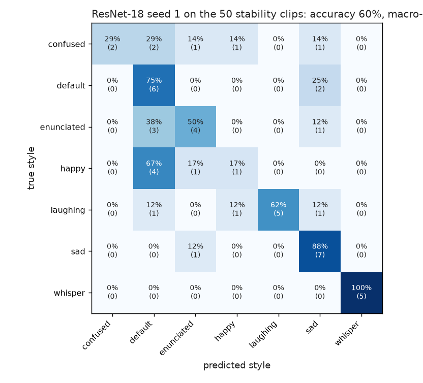

# Stability of the explanations: ResNet-18 (fold 1, seed 1, pretrained), 50 clips

## Setup

- **Clips:** 50 of the 100 explanation clips, stratified by correct / wrong prediction (seed 42): 30 correct, 20 wrong (`stability_clips.csv`). Same model, same 3 fills, same explainer code, explaining the predicted class's logit. Scores over real segments only.
- **Repeats:** 10 per method and fill. LIME: 10 new seeds, 500 samples each. Grad-CAM: run 10 times as a deterministic reference. IG has no randomness with a fixed fill, so it is varied in two ways: **(a)** baseline = the filled clip plus Gaussian noise of sd 1 dB on the filled segments only, a new noise seed per repeat (main IG stability result); **(b)** side check: the 50 integration points jittered, alpha_k = (k + u_k) / 50 with u_k uniform in [0, 1), which tests only the numerical integration. LIME was also repeated with 1,000 samples (the original plan) to see whether its instability comes from the sample count.
- **Between repeats:** for each clip the mean over the 45 pairs of repeats of Kendall's tau-b and top-3 overlap (signed scores; absolute-value versions in the JSON), then the mean, median and minimum over clips. 1 = identical rankings.
- **Small input changes**, applied to the 16 kHz waveform and pushed through the same log-mel pipeline as the cache (rebuilding the clean clips reproduces the cache bit for bit): *noise 40 dB* = white Gaussian noise on the real samples only (padding untouched), variance = mean power of the clip's real samples in the 4 s window / 10^4; *gain +1 dB / -1 dB* = waveform x 10^(+-1/20); *clean rerun* = no change (measures the floor from GPU numerics). A clip is kept only if the predicted-class probability moves by less than 0.05. **Noise at 50 dB SNR was added after seeing the 40 dB result (40 dB moved the prediction for most clips)**; the 40 dB result is kept unchanged. The explanation after the change (same class, LIME with the same seed as the saved run) is compared with the saved one.

Nothing was tuned to make a method look more stable: the settings are the ones used for the main results.

## Repeats: agreement between 10 runs of the same method

| method | fill | clips | Kendall tau: mean | median | min | top-3 overlap: mean | min | clips with the same top 3 in all pairs |
|---|---|---|---|---|---|---|---|---|
| Grad-CAM | none | 50 | 1.000 | 1.000 | 1.000 | 1.000 | 1.000 | 100% |
| LIME 500 samples | silence | 50 | 0.859 | 0.875 | 0.623 | 0.867 | 0.504 | 34% |
| LIME 500 samples | average | 50 | 0.917 | 0.911 | 0.799 | 0.920 | 0.711 | 50% |
| LIME 500 samples | room noise | 50 | 0.892 | 0.908 | 0.752 | 0.901 | 0.681 | 44% |
| IG (a) noisy baseline | silence | 50 | 0.814 | 0.835 | 0.487 | 0.844 | 0.556 | 20% |
| IG (a) noisy baseline | average | 50 | 0.868 | 0.869 | 0.517 | 0.901 | 0.741 | 30% |
| IG (a) noisy baseline | room noise | 50 | 0.826 | 0.843 | 0.630 | 0.853 | 0.637 | 14% |
| IG (b) jittered steps (side check) | silence | 50 | 0.981 | 0.985 | 0.917 | 0.982 | 0.815 | 82% |
| IG (b) jittered steps (side check) | average | 50 | 0.985 | 0.985 | 0.941 | 0.991 | 0.844 | 92% |
| IG (b) jittered steps (side check) | room noise | 50 | 0.980 | 0.986 | 0.867 | 0.985 | 0.822 | 88% |
| LIME 1,000 samples | silence | 50 | 0.900 | 0.903 | 0.703 | 0.903 | 0.548 | 44% |
| LIME 1,000 samples | average | 50 | 0.942 | 0.948 | 0.857 | 0.944 | 0.681 | 66% |
| LIME 1,000 samples | room noise | 50 | 0.925 | 0.934 | 0.821 | 0.929 | 0.667 | 56% |

Split by prediction (Kendall tau mean / top-3 overlap mean):

| method | fill | correct | wrong |
|---|---|---|---|
| Grad-CAM | none | 1.000 / 1.000 | 1.000 / 1.000 |
| LIME 500 samples | silence | 0.855 / 0.858 | 0.866 / 0.881 |
| LIME 500 samples | average | 0.919 / 0.919 | 0.914 / 0.922 |
| LIME 500 samples | room noise | 0.886 / 0.908 | 0.901 / 0.890 |
| IG (a) noisy baseline | silence | 0.809 / 0.832 | 0.820 / 0.861 |
| IG (a) noisy baseline | average | 0.848 / 0.876 | 0.897 / 0.940 |
| IG (a) noisy baseline | room noise | 0.818 / 0.855 | 0.838 / 0.850 |
| IG (b) jittered steps (side check) | silence | 0.979 / 0.979 | 0.985 / 0.987 |
| IG (b) jittered steps (side check) | average | 0.982 / 0.985 | 0.990 / 1.000 |
| IG (b) jittered steps (side check) | room noise | 0.978 / 0.988 | 0.982 / 0.982 |
| LIME 1,000 samples | silence | 0.896 / 0.897 | 0.906 / 0.912 |
| LIME 1,000 samples | average | 0.942 / 0.946 | 0.942 / 0.941 |
| LIME 1,000 samples | room noise | 0.918 / 0.937 | 0.935 / 0.918 |

## Small input changes: explanation before vs after

| change | clips kept (prob. change < 0.05) | median abs prob. change | max | predicted class changed |
|---|---|---|---|---|
| clean rerun | 50 of 50 | 0.0000 | 0.0000 | 0 |
| noise 40db | 16 of 50 | 0.2307 | 0.9773 | 22 |
| gain plus 1db | 43 of 50 | 0.0088 | 0.0958 | 0 |
| gain minus 1db | 41 of 50 | 0.0131 | 0.1021 | 2 |
| noise 50db | 17 of 50 | 0.1166 | 0.9267 | 14 |

| change | method | fill | clips | Kendall tau: mean | median | min | top-3 overlap: mean | min | same top 3 |
|---|---|---|---|---|---|---|---|---|---|
| clean rerun | Grad-CAM | none | 50 | 1.000 | 1.000 | 1.000 | 1.000 | 1.000 | 100% |
| clean rerun | IG | silence | 50 | 1.000 | 1.000 | 1.000 | 1.000 | 1.000 | 100% |
| clean rerun | LIME | silence | 50 | 1.000 | 1.000 | 1.000 | 1.000 | 1.000 | 100% |
| clean rerun | IG | average | 50 | 1.000 | 1.000 | 1.000 | 1.000 | 1.000 | 100% |
| clean rerun | LIME | average | 50 | 1.000 | 1.000 | 1.000 | 1.000 | 1.000 | 100% |
| clean rerun | IG | room noise | 50 | 1.000 | 1.000 | 1.000 | 1.000 | 1.000 | 100% |
| clean rerun | LIME | room noise | 50 | 1.000 | 1.000 | 1.000 | 1.000 | 1.000 | 100% |
| noise 40db | Grad-CAM | none | 16 | 0.760 | 0.856 | 0.000 | 0.792 | 0.000 | 69% |
| noise 40db | IG | silence | 16 | 0.572 | 0.611 | 0.154 | 0.688 | 0.333 | 19% |
| noise 40db | LIME | silence | 16 | 0.716 | 0.721 | 0.500 | 0.729 | 0.333 | 25% |
| noise 40db | IG | average | 16 | 0.590 | 0.635 | 0.286 | 0.688 | 0.333 | 12% |
| noise 40db | LIME | average | 16 | 0.713 | 0.733 | 0.286 | 0.771 | 0.333 | 44% |
| noise 40db | IG | room noise | 16 | 0.623 | 0.630 | 0.308 | 0.812 | 0.333 | 50% |
| noise 40db | LIME | room noise | 16 | 0.694 | 0.713 | 0.429 | 0.875 | 0.667 | 62% |
| gain plus 1db | Grad-CAM | none | 43 | 0.984 | 1.000 | 0.822 | 1.000 | 1.000 | 100% |
| gain plus 1db | IG | silence | 43 | 0.976 | 1.000 | 0.833 | 0.984 | 0.667 | 95% |
| gain plus 1db | LIME | silence | 43 | 0.977 | 1.000 | 0.833 | 0.977 | 0.667 | 93% |
| gain plus 1db | IG | average | 43 | 0.969 | 0.981 | 0.855 | 0.938 | 0.667 | 81% |
| gain plus 1db | LIME | average | 43 | 0.978 | 1.000 | 0.850 | 0.969 | 0.667 | 91% |
| gain plus 1db | IG | room noise | 43 | 0.971 | 0.983 | 0.733 | 0.992 | 0.667 | 98% |
| gain plus 1db | LIME | room noise | 43 | 0.975 | 0.983 | 0.905 | 0.961 | 0.667 | 88% |
| gain minus 1db | Grad-CAM | none | 41 | 0.975 | 0.983 | 0.810 | 0.992 | 0.667 | 98% |
| gain minus 1db | IG | silence | 41 | 0.983 | 1.000 | 0.929 | 0.992 | 0.667 | 98% |
| gain minus 1db | LIME | silence | 41 | 0.984 | 1.000 | 0.889 | 0.984 | 0.667 | 95% |
| gain minus 1db | IG | average | 41 | 0.976 | 0.983 | 0.890 | 0.992 | 0.667 | 98% |
| gain minus 1db | LIME | average | 41 | 0.984 | 1.000 | 0.867 | 1.000 | 1.000 | 100% |
| gain minus 1db | IG | room noise | 41 | 0.962 | 0.967 | 0.778 | 0.967 | 0.667 | 90% |
| gain minus 1db | LIME | room noise | 41 | 0.976 | 0.983 | 0.867 | 0.984 | 0.667 | 95% |
| noise 50db | Grad-CAM | none | 17 | 0.769 | 0.872 | 0.233 | 0.843 | 0.000 | 76% |
| noise 50db | IG | silence | 17 | 0.725 | 0.733 | 0.500 | 0.784 | 0.333 | 41% |
| noise 50db | LIME | silence | 17 | 0.774 | 0.818 | 0.538 | 0.863 | 0.667 | 59% |
| noise 50db | IG | average | 17 | 0.686 | 0.733 | 0.357 | 0.784 | 0.333 | 47% |
| noise 50db | LIME | average | 17 | 0.773 | 0.783 | 0.550 | 0.843 | 0.333 | 59% |
| noise 50db | IG | room noise | 17 | 0.719 | 0.783 | 0.429 | 0.804 | 0.667 | 41% |
| noise 50db | LIME | room noise | 17 | 0.785 | 0.788 | 0.604 | 0.922 | 0.667 | 76% |

Split by prediction (Kendall tau mean / top-3 overlap mean; noise and gain only):

| change | method | fill | correct | wrong |
|---|---|---|---|---|
| noise 40db | Grad-CAM | none | 0.749 / 0.762 (n=14) | 0.832 / 1.000 (n=2) |
| noise 40db | IG | silence | 0.575 / 0.690 (n=14) | 0.552 / 0.667 (n=2) |
| noise 40db | LIME | silence | 0.721 / 0.738 (n=14) | 0.685 / 0.667 (n=2) |
| noise 40db | IG | average | 0.581 / 0.690 (n=14) | 0.652 / 0.667 (n=2) |
| noise 40db | LIME | average | 0.708 / 0.786 (n=14) | 0.752 / 0.667 (n=2) |
| noise 40db | IG | room noise | 0.646 / 0.833 (n=14) | 0.463 / 0.667 (n=2) |
| noise 40db | LIME | room noise | 0.693 / 0.905 (n=14) | 0.703 / 0.667 (n=2) |
| gain plus 1db | Grad-CAM | none | 0.982 / 1.000 (n=28) | 0.989 / 1.000 (n=15) |
| gain plus 1db | IG | silence | 0.977 / 0.976 (n=28) | 0.974 / 1.000 (n=15) |
| gain plus 1db | LIME | silence | 0.982 / 0.964 (n=28) | 0.967 / 1.000 (n=15) |
| gain plus 1db | IG | average | 0.964 / 0.917 (n=28) | 0.978 / 0.978 (n=15) |
| gain plus 1db | LIME | average | 0.972 / 0.952 (n=28) | 0.989 / 1.000 (n=15) |
| gain plus 1db | IG | room noise | 0.972 / 1.000 (n=28) | 0.971 / 0.978 (n=15) |
| gain plus 1db | LIME | room noise | 0.973 / 0.964 (n=28) | 0.977 / 0.956 (n=15) |
| gain minus 1db | Grad-CAM | none | 0.981 / 0.988 (n=28) | 0.963 / 1.000 (n=13) |
| gain minus 1db | IG | silence | 0.978 / 0.988 (n=28) | 0.993 / 1.000 (n=13) |
| gain minus 1db | LIME | silence | 0.988 / 0.976 (n=28) | 0.975 / 1.000 (n=13) |
| gain minus 1db | IG | average | 0.973 / 0.988 (n=28) | 0.982 / 1.000 (n=13) |
| gain minus 1db | LIME | average | 0.981 / 1.000 (n=28) | 0.989 / 1.000 (n=13) |
| gain minus 1db | IG | room noise | 0.964 / 0.964 (n=28) | 0.957 / 0.974 (n=13) |
| gain minus 1db | LIME | room noise | 0.973 / 0.988 (n=28) | 0.981 / 0.974 (n=13) |
| noise 50db | Grad-CAM | none | 0.769 / 0.843 (n=17) | no clips |
| noise 50db | IG | silence | 0.725 / 0.784 (n=17) | no clips |
| noise 50db | LIME | silence | 0.774 / 0.863 (n=17) | no clips |
| noise 50db | IG | average | 0.686 / 0.784 (n=17) | no clips |
| noise 50db | LIME | average | 0.773 / 0.843 (n=17) | no clips |
| noise 50db | IG | room noise | 0.719 / 0.804 (n=17) | no clips |
| noise 50db | LIME | room noise | 0.785 / 0.922 (n=17) | no clips |

## ResNet-18 on these 50 clips (CLAUDE.md rule)

Accuracy 60.0%, macro-F1 0.596. Rows = true style, columns = predicted style; each box the share of its row and the clip count.

| style | clips | precision | recall | F1 |
|---|---|---|---|---|
| confused | 7 | 1.00 | 0.29 | 0.44 |
| default | 8 | 0.38 | 0.75 | 0.50 |
| enunciated | 8 | 0.57 | 0.50 | 0.53 |
| happy | 6 | 0.33 | 0.17 | 0.22 |
| laughing | 8 | 1.00 | 0.62 | 0.77 |
| sad | 8 | 0.58 | 0.88 | 0.70 |
| whisper | 5 | 1.00 | 1.00 | 1.00 |
| **macro average** | 50 | **0.69** | **0.60** | **0.60** |

Files: `stability_clips.csv`, `stability_repeats.csv`, `stability_ig_repeats.csv` (when run), `stability_perturbed_scores.csv`, `stability_perturbed_probs.csv`, `stability_metrics.json`.
