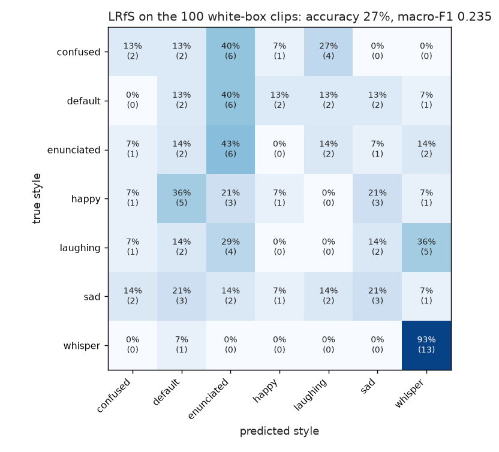

# White-box check: IG and LIME on LRfS, fold 1 (test actor ex02)

LRfS (logistic regression on 16 segment means, `reports/lrfs_fold1/report.md`) has exact segment contributions, so we know the true answer. Integrated Gradients and LIME are run on it with the same code that will run on the ResNet (`src/explain/`), on the same standardised 128 x 400 input, and scored against that truth. Grad-CAM needs a convolutional layer and is covered by the sanity check instead.

## Setup

- **Clips:** 100 fold-1 test clips, stratified by true style, seed 42, chosen without looking at any model's prediction (`clips_fold1.csv`; the ResNet explainers reuse this list). Real segments per clip: mean 12.1, min 5, max 16.
- **Explained quantity:** the logit of LRfS's predicted class, as in the exact contributions.
- **Truth:** phi_j = V_cj (x_j - f) on real segments, with the **same fill** f the explainer uses. The truth depends on the fill, so every result is reported per fill.
- **Integrated Gradients:** 50 steps (midpoint Riemann sum), baseline = the clip with every real segment replaced by the fill (padding unchanged); pixel attributions summed per segment.
- **LIME:** 500 samples; the features are the clip's real segments, a segment switched off gets the fill; lime_image defaults otherwise (first sample = original clip, uniform on/off, cosine distance, kernel width 0.25, weighted Ridge alpha 1). Implemented in `src/explain/lime_segments.py` (the `lime` package is not installed).
- **Scores, over real segments only:** Kendall's tau-b between explainer and truth on signed values (main) and on absolute values; top-3 overlap = share of the truth's 3 highest segments that are also the explainer's 3 highest, on signed values (segments that most support the prediction) and on absolute values.

Fills (train clips of fold 1 only, mean over the 128 bands): room noise -78.23 dB, average -45.74 dB, silence -100.00 dB.

## Results (100 clips)

| fill | method | Kendall tau: mean | median | min | tau on abs values: mean | top-3 overlap: mean | all 3 found | top-3 overlap, abs: mean | check |
|---|---|---|---|---|---|---|---|---|---|
| room noise | IG | 1.000 | 1.000 | 1.000 | 1.000 | 1.000 | 100% | 1.000 | IG completeness gap max 1.8e-06 |
| room noise | LIME | 0.995 | 1.000 | 0.927 | 0.990 | 0.997 | 99% | 1.000 | LIME R2 0.9997 |
| average | IG | 1.000 | 1.000 | 1.000 | 1.000 | 1.000 | 100% | 1.000 | IG completeness gap max 8.9e-07 |
| average | LIME | 0.985 | 1.000 | 0.846 | 0.969 | 1.000 | 100% | 0.993 | LIME R2 0.9997 |
| silence | IG | 1.000 | 1.000 | 1.000 | 1.000 | 1.000 | 100% | 1.000 | IG completeness gap max 1.1e-06 |
| silence | LIME | 0.997 | 1.000 | 0.944 | 0.994 | 0.997 | 99% | 0.997 | LIME R2 0.9997 |

IG completeness gap = sum of IG attributions minus (logit of the clip - logit of the baseline).

## LRfS on these 100 clips (CLAUDE.md rule)

Accuracy 27.0%, macro-F1 0.235 (full test actor: `reports/lrfs_fold1/report.md`). Rows = true style, columns = predicted style; each box the share of its row and the clip count.

| style | clips | precision | recall | F1 |
|---|---|---|---|---|
| confused | 15 | 0.29 | 0.13 | 0.18 |
| default | 15 | 0.12 | 0.13 | 0.12 |
| enunciated | 14 | 0.22 | 0.43 | 0.29 |
| happy | 14 | 0.20 | 0.07 | 0.11 |
| laughing | 14 | 0.00 | 0.00 | 0.00 |
| sad | 14 | 0.27 | 0.21 | 0.24 |
| whisper | 14 | 0.57 | 0.93 | 0.70 |
| **macro average** | 100 | **0.24** | **0.27** | **0.24** |

Files: `whitebox_lrfs_per_clip.csv` (scores per clip, fill and method), `whitebox_lrfs_attributions.csv` (16 segment values per clip, fill and method, plus the truth), `whitebox_lrfs_metrics.json`.
