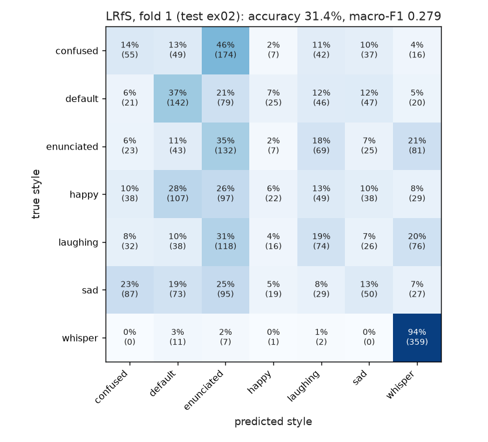

# LRfS (logistic regression on 16 segments of 250 ms), fold 1

LRfS is a **white-box check for the explainers**, not a competing classifier. Its exact segment contributions are known, so LIME and Integrated Gradients are scored against them with Kendall's tau, in the same 16-segment space, with the same fill, ranking real segments only. Grad-CAM needs a convolutional layer and is covered by the sanity check instead.

## Model

- **Features (16 per clip):** x_j = mean of the stored log-mel (dB) over all 128 mel bands and all 25 frames of segment j (250 ms), padding frames counted at -100 dB. This is an exact linear function of the same 128 x 400 input the ResNet gets.
- **Data:** fold 1; trained on the train split of ex01, ex03, ex04 (6381 clips); C chosen on the val split of the same actors (1595 clips); test actor ex02 (2660 clips) used once, after C was fixed.
- **Fit:** StandardScaler on the train split, multinomial logistic regression (L2, lbfgs, random_state 42). The scaler is folded into the weights: logit_c = b0_c + sum_j V_cj x_j, with V in logit per dB.
- **Same input as the ResNet:** `src.models.lrfs.LRfSTorch` takes the standardised [N, 1, 128, 400] ResNet input and returns the same logits, so the explainer code runs unchanged on both models.

## Choosing C (validation, same 3 actors as training)

| C | val macro-F1 | val accuracy | train accuracy | chosen |
|---|---|---|---|---|
| 0.001 | 0.2717 | 31.3% | 30.6% |  |
| 0.01 | 0.2791 | 30.7% | 31.3% |  |
| 0.1 | 0.2832 | 30.7% | 31.5% |  |
| 1 | 0.2888 | 31.1% | 31.5% | yes |
| 10 | 0.2883 | 31.0% | 31.6% |  |
| 100 | 0.2883 | 31.0% | 31.6% |  |

Rule: highest validation macro-F1; on a tie, the smaller C (stronger regularisation).

## Test result (actor ex02, used once)

| model (same test clips) | accuracy | macro-F1 |
|---|---|---|
| **LRfS** | **31.4%** | **0.279** |
| ResNet-18 pretrained, seed 1 (the explained model) | 68.6% | 0.670 |
| Length only (duration_s, was_cropped) | 19.5% | 0.141 |
| Chance | 14.3% | |

LRfS and the ResNet give the same prediction for 34.3% of the test clips.

### Test confusion matrix

Rows = true style, columns = predicted style; each box shows the share of its row and the clip count.

### Per-style precision, recall, F1 (test)

| style | test clips | precision | recall | F1 |
|---|---|---|---|---|
| confused | 380 | 0.21 | 0.14 | 0.17 |
| default | 380 | 0.31 | 0.37 | 0.34 |
| enunciated | 380 | 0.19 | 0.35 | 0.24 |
| happy | 380 | 0.23 | 0.06 | 0.09 |
| laughing | 380 | 0.24 | 0.19 | 0.21 |
| sad | 380 | 0.22 | 0.13 | 0.17 |
| whisper | 380 | 0.59 | 0.94 | 0.73 |
| **macro average** | 2660 | **0.28** | **0.31** | **0.28** |

## Weights V (logit change per +1 dB of a segment's mean)

| style | s0 | s1 | s2 | s3 | s4 | s5 | s6 | s7 | s8 | s9 | s10 | s11 | s12 | s13 | s14 | s15 |
|---|---|---|---|---|---|---|---|---|---|---|---|---|---|---|---|---|
| confused | -0.115 | -0.021 | -0.005 | -0.004 | +0.001 | -0.002 | -0.000 | -0.000 | +0.000 | +0.005 | +0.001 | -0.004 | -0.002 | +0.007 | -0.002 | +0.001 |
| default | -0.030 | +0.011 | +0.002 | -0.012 | -0.001 | +0.001 | -0.005 | -0.002 | -0.004 | -0.001 | -0.007 | +0.004 | -0.004 | -0.002 | +0.007 | -0.009 |
| enunciated | -0.051 | +0.015 | -0.037 | -0.006 | -0.014 | -0.005 | -0.007 | +0.013 | -0.001 | +0.006 | -0.000 | +0.004 | +0.011 | -0.003 | -0.002 | +0.009 |
| happy | -0.024 | +0.000 | +0.012 | -0.003 | -0.003 | +0.003 | -0.001 | -0.006 | +0.004 | -0.010 | +0.006 | -0.006 | +0.001 | -0.000 | -0.001 | -0.003 |
| laughing | -0.007 | -0.040 | -0.007 | +0.009 | +0.007 | +0.002 | +0.009 | -0.005 | +0.001 | +0.009 | -0.006 | +0.003 | -0.003 | +0.006 | -0.003 | +0.003 |
| sad | -0.076 | -0.029 | -0.001 | -0.005 | -0.003 | -0.005 | +0.004 | -0.002 | +0.001 | -0.002 | -0.002 | +0.008 | -0.007 | -0.003 | -0.001 | +0.002 |
| whisper | +0.304 | +0.065 | +0.037 | +0.021 | +0.012 | +0.006 | -0.001 | +0.002 | -0.001 | -0.006 | +0.008 | -0.008 | +0.005 | -0.004 | +0.001 | -0.004 |

## Exact segment contributions

Contributions are for the **predicted class's logit** (c = argmax), because the ResNet explainers must explain the same quantity. For each real segment j and fill f:

    phi_j = V_cj * (x_j - f)

Pure padding segments are set to 0. **The exact-sum identity holds over real segments only:** sum over real j of phi_j = logit_c(clip) - logit_c(clip with every real segment filled); padding segments stay at -100 dB on both sides, so their part of the logit is not attributed. A segment that is only partly real counts as real; filling it replaces all 25 frames.

The scalar fill f is the mean over the 128 bands of the train-only per-band fill (`fill_values_fold_1.json`); in the spectrogram the per-band values are written into the segment, which sets x_j to exactly f. The three fills are the plan's: silence (-100 dB, the padding value), the average spectrogram of the training clips (per-band mean) and a room-noise level (per-band 10th percentile), all from training clips only. The true contributions depend on the fill, so explainers are scored against each fill separately, using the same fill.

| fill | f (dB) | role | max error of the sum identity | max error, single-segment deletion (50 clips) |
|---|---|---|---|---|
| room noise | -78.23 | main | 2.0e-12 | 6.7e-15 |
| average | -45.74 | second | 1.3e-12 | 5.8e-15 |
| silence | -100.00 | comparison (= padding value) | 5.4e-12 | 1.1e-14 |

Both errors were measured by actually writing the fill into the 128 x 400 spectrogram and recomputing the logit (float64), not from the 16 features.

Mean |phi| per segment position over test clips where that segment is real, and the share of test clips in which that segment is real:

| fill | s0 | s1 | s2 | s3 | s4 | s5 | s6 | s7 | s8 | s9 | s10 | s11 | s12 | s13 | s14 | s15 |
|---|---|---|---|---|---|---|---|---|---|---|---|---|---|---|---|---|
| room noise | 1.73 | 1.14 | 0.68 | 0.35 | 0.25 | 0.12 | 0.13 | 0.17 | 0.03 | 0.18 | 0.10 | 0.14 | 0.21 | 0.12 | 0.04 | 0.18 |
| average | 1.77 | 0.23 | 0.16 | 0.08 | 0.07 | 0.03 | 0.04 | 0.05 | 0.02 | 0.07 | 0.05 | 0.07 | 0.08 | 0.05 | 0.02 | 0.08 |
| silence | 4.06 | 1.79 | 1.12 | 0.58 | 0.42 | 0.20 | 0.22 | 0.29 | 0.06 | 0.31 | 0.16 | 0.23 | 0.35 | 0.20 | 0.07 | 0.30 |
| real share | 100% | 100% | 100% | 100% | 99% | 98% | 94% | 89% | 83% | 76% | 67% | 58% | 50% | 44% | 38% | 33% |

## Checks

- Folded linear form vs scikit-learn logits: max difference 2.6e-14.
- `LRfSTorch` on the standardised ResNet input vs scikit-learn logits: max difference 2.7e-07; same predicted class for every clip: True.
- The real-segment rule (segment start < n_frames_valid) matches `is_real_audio` in `segments.csv` for every train, val and test clip.

Files: `models/lrfs_fold1/` (`lrfs.npz`, `settings.json`, `test_predictions.csv`, `contributions_test.csv`: one row per test clip and fill, columns phi_s00..phi_s15).
