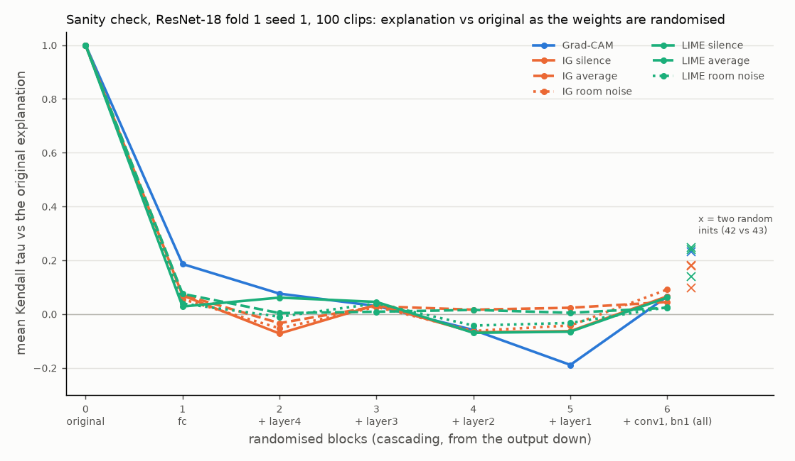
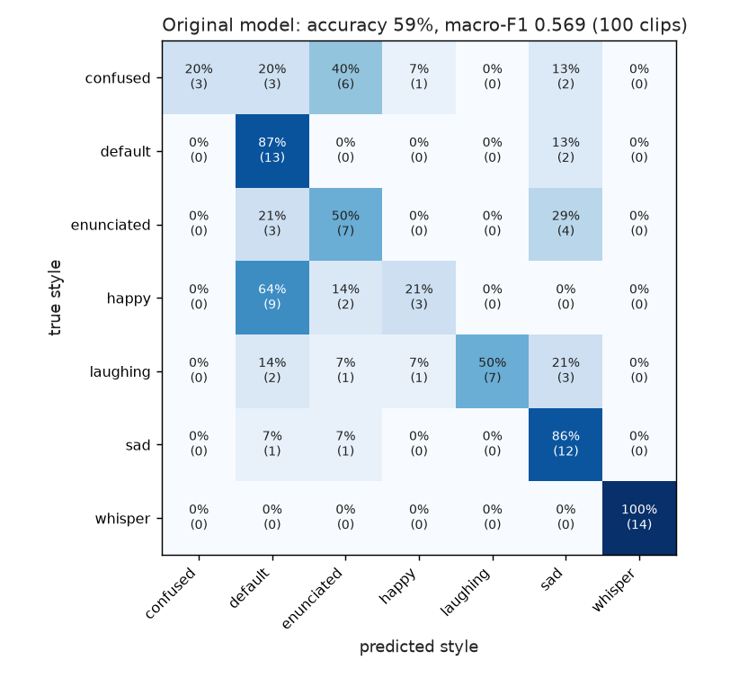
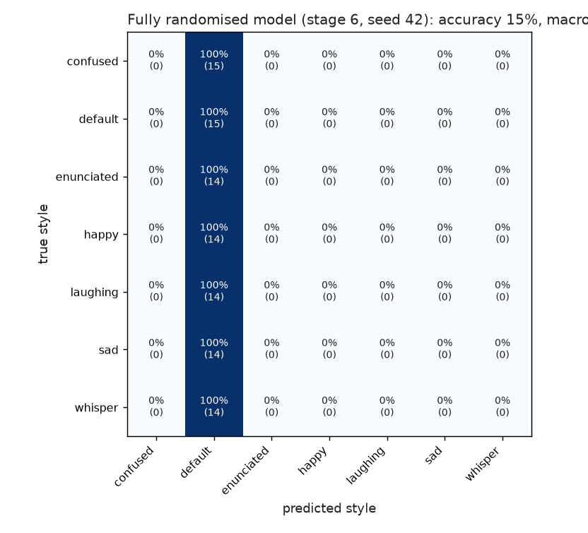

# Sanity check: model-parameter randomisation, ResNet-18 fold 1 seed 1 (100 clips)

**Question:** do the Grad-CAM, IG and LIME explanations depend on what the model learned? If the learned weights are destroyed and the explanation stays the same, the explanation is not about the model.

## Design (fixed before the results; see DECISIONS.md)

- Model: `models/fold1_seed1_pretrained/best.pt`, loaded as an in-memory copy, float32, eval mode; the file is never written.
- Cascading randomisation from the top down: stage 0 = original; stage 1 = fc; stage 2 = + layer4; stage 3 = + layer3; stage 4 = + layer2; stage 5 = + layer1; stage 6 = + conv1, bn1 (all). Re-initialised with PyTorch's default init per layer type (`reset_parameters()`), `torch.manual_seed(42)` once, blocks in that fixed order, so each stage keeps the previous stage's random blocks. Batch-norm layers in a randomised block: weight, bias and running statistics reset.
- Same 100 fold-1 test clips (`clips_fold1.csv`), same fills (fold-1 train: room noise -78.23 dB, average -45.74 dB, silence -100 dB), same explainer code and settings as the main run (Grad-CAM on layer4, IG 50 steps, LIME 500 samples with the same seeds), real segments only.
- **Target: the ORIGINAL model's predicted class for each clip, explained as its logit on every randomised model**, so every stage explains the same quantity.
- Each stage's explanation is compared with the saved original (`reports/explain_fold1/resnet_segment_scores.csv`): Kendall tau-b on signed scores (main) and on absolute values, top-3 overlap (signed), share of clips with the same top-1 segment; mean, median and minimum over clips.
- Undefined tau (scores constant over the real segments, e.g. Grad-CAM zero everywhere after its ReLU): the clip is left out of that mean and counted in *excluded*; it is never filled with 0.
- Controls: (a) stage 0 rerun vs the saved original; (b) a second fully random model (seed 43) vs the seed-42 one, to show how similar two meaningless explanations are by chance.
- Wording fixed in advance, by mean signed tau at stage 6: below 0.3 *changes strongly*, 0.3 to 0.7 *partly changes*, above 0.7 *barely changes*. No pass/fail threshold.

## The model at each stage (100 clips)

| stage | randomised | accuracy | macro-F1 | same prediction as the original | mean logit of the target class |
|---|---|---|---|---|---|
| 0 | original | 59.0% | 0.569 | 100% | 5.73 |
| 1 | fc | 23.0% | 0.119 | 30% | -0.12 |
| 2 | + layer4 | 13.0% | 0.064 | 26% | 0.01 |
| 3 | + layer3 | 15.0% | 0.038 | 31% | -0.00 |
| 4 | + layer2 | 15.0% | 0.037 | 31% | 0.00 |
| 5 | + layer1 | 15.0% | 0.037 | 31% | -0.00 |
| 6 | + conv1, bn1 (all) | 15.0% | 0.037 | 31% | 0.01 |
| 6 (seed 43) | all, second init | 14.0% | 0.036 | 14% | -0.02 |

Chance accuracy is 14.3% (1 of 7).

## Result at stage 6 (fully random model), in the fixed wording

| method | fill | mean tau at stage 6 | wording | random vs random (seed 42 vs 43): mean tau |
|---|---|---|---|---|
| Grad-CAM | none | 0.066 | **changes strongly** | 0.232 |
| IG  | silence | 0.066 | **changes strongly** | 0.181 |
| IG  | average | 0.045 | **changes strongly** | 0.097 |
| IG  | room noise | 0.091 | **changes strongly** | 0.180 |
| LIME  | silence | 0.062 | **changes strongly** | 0.248 |
| LIME  | average | 0.023 | **changes strongly** | 0.138 |
| LIME  | room noise | 0.025 | **changes strongly** | 0.241 |

## Per method and fill, at every stage (compared with the saved original)

### Grad-CAM

| stage | randomised | clips | excluded (undefined tau) | tau mean | tau median | tau min | tau on abs values: mean | top-3 overlap | same top-1 |
|---|---|---|---|---|---|---|---|---|---|
| 0 | original | 100 | 0 | 1.000 | 1.000 | 0.995 | 1.000 | 1.000 | 100% |
| 1 | fc | 87 | 13 | 0.186 | 0.238 | -0.681 | 0.186 | 0.452 | 10% |
| 2 | + layer4 | 85 | 15 | 0.076 | 0.067 | -0.714 | 0.076 | 0.365 | 5% |
| 3 | + layer3 | 92 | 8 | 0.030 | 0.054 | -0.745 | 0.030 | 0.286 | 10% |
| 4 | + layer2 | 85 | 15 | -0.059 | -0.067 | -0.733 | -0.059 | 0.231 | 5% |
| 5 | + layer1 | 61 | 39 | -0.189 | -0.181 | -0.810 | -0.189 | 0.164 | 2% |
| 6 | + conv1, bn1 (all) | 96 | 4 | 0.066 | 0.105 | -1.000 | 0.066 | 0.319 | 6% |
| control | seed 42 vs seed 43, both fully random | 87 | 13 | 0.232 | 0.233 | -0.556 | 0.232 | 0.429 | 26% |

### IG silence

| stage | randomised | clips | excluded (undefined tau) | tau mean | tau median | tau min | tau on abs values: mean | top-3 overlap | same top-1 |
|---|---|---|---|---|---|---|---|---|---|
| 0 | original | 100 | 0 | 0.999 | 1.000 | 0.929 | 0.999 | 0.997 | 100% |
| 1 | fc | 100 | 0 | 0.069 | 0.061 | -0.867 | 0.144 | 0.367 | 20% |
| 2 | + layer4 | 100 | 0 | -0.072 | -0.061 | -0.643 | 0.041 | 0.227 | 5% |
| 3 | + layer3 | 100 | 0 | 0.035 | 0.033 | -0.485 | 0.025 | 0.293 | 12% |
| 4 | + layer2 | 100 | 0 | -0.067 | -0.055 | -0.619 | 0.062 | 0.260 | 4% |
| 5 | + layer1 | 100 | 0 | -0.063 | -0.061 | -0.733 | 0.054 | 0.257 | 6% |
| 6 | + conv1, bn1 (all) | 100 | 0 | 0.066 | 0.055 | -0.600 | 0.037 | 0.310 | 5% |
| control | seed 42 vs seed 43, both fully random | 100 | 0 | 0.181 | 0.200 | -0.611 | 0.198 | 0.450 | 28% |

### IG average

| stage | randomised | clips | excluded (undefined tau) | tau mean | tau median | tau min | tau on abs values: mean | top-3 overlap | same top-1 |
|---|---|---|---|---|---|---|---|---|---|
| 0 | original | 100 | 0 | 1.000 | 1.000 | 1.000 | 1.000 | 1.000 | 100% |
| 1 | fc | 100 | 0 | 0.072 | 0.128 | -0.857 | 0.178 | 0.380 | 14% |
| 2 | + layer4 | 100 | 0 | -0.034 | 0.000 | -0.644 | 0.060 | 0.267 | 15% |
| 3 | + layer3 | 100 | 0 | 0.029 | 0.031 | -0.643 | 0.057 | 0.333 | 12% |
| 4 | + layer2 | 100 | 0 | 0.016 | 0.000 | -0.467 | -0.039 | 0.247 | 7% |
| 5 | + layer1 | 100 | 0 | 0.023 | 0.022 | -0.515 | 0.013 | 0.293 | 16% |
| 6 | + conv1, bn1 (all) | 100 | 0 | 0.045 | 0.053 | -0.600 | 0.077 | 0.297 | 22% |
| control | seed 42 vs seed 43, both fully random | 100 | 0 | 0.097 | 0.077 | -0.733 | 0.193 | 0.413 | 20% |

### IG room noise

| stage | randomised | clips | excluded (undefined tau) | tau mean | tau median | tau min | tau on abs values: mean | top-3 overlap | same top-1 |
|---|---|---|---|---|---|---|---|---|---|
| 0 | original | 100 | 0 | 1.000 | 1.000 | 0.974 | 0.999 | 1.000 | 100% |
| 1 | fc | 100 | 0 | 0.056 | 0.075 | -0.867 | 0.201 | 0.367 | 24% |
| 2 | + layer4 | 100 | 0 | -0.053 | -0.039 | -0.786 | 0.046 | 0.263 | 9% |
| 3 | + layer3 | 100 | 0 | 0.027 | 0.005 | -0.418 | 0.037 | 0.310 | 11% |
| 4 | + layer2 | 100 | 0 | -0.063 | -0.055 | -0.619 | 0.043 | 0.247 | 6% |
| 5 | + layer1 | 100 | 0 | -0.042 | -0.028 | -0.722 | 0.004 | 0.270 | 11% |
| 6 | + conv1, bn1 (all) | 100 | 0 | 0.091 | 0.081 | -0.822 | 0.028 | 0.333 | 22% |
| control | seed 42 vs seed 43, both fully random | 100 | 0 | 0.180 | 0.164 | -0.600 | 0.131 | 0.423 | 27% |

### LIME silence

| stage | randomised | clips | excluded (undefined tau) | tau mean | tau median | tau min | tau on abs values: mean | top-3 overlap | same top-1 |
|---|---|---|---|---|---|---|---|---|---|
| 0 | original | 100 | 0 | 1.000 | 1.000 | 1.000 | 1.000 | 1.000 | 100% |
| 1 | fc | 100 | 0 | 0.028 | -0.035 | -0.956 | 0.139 | 0.347 | 23% |
| 2 | + layer4 | 100 | 0 | 0.061 | 0.061 | -0.429 | 0.066 | 0.317 | 35% |
| 3 | + layer3 | 100 | 0 | 0.045 | 0.033 | -0.500 | 0.049 | 0.287 | 11% |
| 4 | + layer2 | 100 | 0 | -0.070 | -0.067 | -0.905 | 0.074 | 0.243 | 6% |
| 5 | + layer1 | 100 | 0 | -0.065 | -0.059 | -0.500 | 0.011 | 0.247 | 3% |
| 6 | + conv1, bn1 (all) | 100 | 0 | 0.062 | 0.058 | -0.429 | -0.018 | 0.330 | 5% |
| control | seed 42 vs seed 43, both fully random | 100 | 0 | 0.248 | 0.281 | -0.500 | 0.271 | 0.523 | 38% |

### LIME average

| stage | randomised | clips | excluded (undefined tau) | tau mean | tau median | tau min | tau on abs values: mean | top-3 overlap | same top-1 |
|---|---|---|---|---|---|---|---|---|---|
| 0 | original | 100 | 0 | 1.000 | 1.000 | 1.000 | 1.000 | 1.000 | 100% |
| 1 | fc | 100 | 0 | 0.075 | 0.050 | -0.788 | 0.151 | 0.357 | 28% |
| 2 | + layer4 | 100 | 0 | 0.004 | 0.040 | -0.500 | 0.097 | 0.297 | 29% |
| 3 | + layer3 | 100 | 0 | 0.009 | 0.000 | -0.714 | 0.004 | 0.300 | 8% |
| 4 | + layer2 | 100 | 0 | 0.016 | 0.017 | -0.636 | -0.061 | 0.243 | 4% |
| 5 | + layer1 | 100 | 0 | 0.005 | 0.020 | -0.667 | 0.048 | 0.290 | 12% |
| 6 | + conv1, bn1 (all) | 100 | 0 | 0.023 | 0.028 | -0.600 | 0.071 | 0.287 | 29% |
| control | seed 42 vs seed 43, both fully random | 100 | 0 | 0.138 | 0.152 | -0.733 | 0.206 | 0.427 | 20% |

### LIME room noise

| stage | randomised | clips | excluded (undefined tau) | tau mean | tau median | tau min | tau on abs values: mean | top-3 overlap | same top-1 |
|---|---|---|---|---|---|---|---|---|---|
| 0 | original | 100 | 0 | 1.000 | 1.000 | 1.000 | 1.000 | 1.000 | 100% |
| 1 | fc | 100 | 0 | 0.039 | -0.005 | -0.800 | 0.135 | 0.370 | 25% |
| 2 | + layer4 | 100 | 0 | -0.010 | -0.033 | -0.786 | 0.083 | 0.293 | 22% |
| 3 | + layer3 | 100 | 0 | 0.039 | 0.017 | -0.500 | 0.013 | 0.277 | 16% |
| 4 | + layer2 | 100 | 0 | -0.043 | -0.058 | -0.673 | 0.017 | 0.270 | 4% |
| 5 | + layer1 | 100 | 0 | -0.033 | -0.029 | -0.527 | 0.002 | 0.277 | 9% |
| 6 | + conv1, bn1 (all) | 100 | 0 | 0.025 | 0.028 | -0.673 | -0.007 | 0.317 | 20% |
| control | seed 42 vs seed 43, both fully random | 100 | 0 | 0.241 | 0.258 | -0.800 | 0.148 | 0.477 | 31% |

## Control (a): stage 0 rerun vs the saved original

Mean tau 0.999 or higher for every method and fill, same top-1 segment in 100% of clips; lowest single-clip tau 0.929 (IG). The design asked for 1.000. LIME and Grad-CAM reproduce the saved scores up to the 6-digit rounding of the saved file (relative differences about 1e-6); IG differs by up to 0.1% of its largest score because summed GPU gradients are not bit-reproducible (some GPU operations have no deterministic version; noted in DECISIONS.md). That is enough to swap nearly tied segments in a few clips. Nothing was changed to force 1.000; this is the noise floor of every comparison below, and it is far above every later stage.

## What this shows and does not show

- Result in the fixed wording: at stage 6 every method and fill **changes strongly** (mean tau 0.02 to 0.09). Randomising only the output layer (fc) already drops the mean tau to 0.03 to 0.19, so the explanations depend on the learned read-out, not only on the input. Grad-CAM keeps the most structure after fc alone (0.19), because its layer4 activations are still the learned ones at that stage.
- Agreement with the original at stage 6 is **below** the agreement between two random models (seed 42 vs 43: 0.10 to 0.25). Two random networks share some input-driven structure (for example the louder segments); the original explanation does not resemble that structure.
- It shows whether each explanation **depends on the learned weights**: if the ranking of segments stays close to the original after the weights are destroyed, it is driven by the input (or the method) rather than by what the model learned.
- The random-vs-random control shows how much agreement two meaningless models give by chance; agreement with the original at stage 6 should be compared with that level, not with 0.
- It does **not** show that an explanation is faithful or correct. Passing (the explanation changes when the weights change) is necessary, not sufficient: an explanation can depend on the weights and still point at the wrong segments. Faithfulness is tested by the deletion curves, the white-box check and the planted-tone test.
- Randomising from the top down measures dependence on the upper layers first; early stages change the target logit's meaning only through fc and layer4.

## Original model (stage 0) on the 100 clips: confusion matrix and per-style metrics (CLAUDE.md rule)

Rows = true style, columns = predicted style; each box the share of its row and the clip count.

| style | clips | precision | recall | F1 |
|---|---|---|---|---|
| confused | 15 | 1.00 | 0.20 | 0.33 |
| default | 15 | 0.42 | 0.87 | 0.57 |
| enunciated | 14 | 0.41 | 0.50 | 0.45 |
| happy | 14 | 0.60 | 0.21 | 0.32 |
| laughing | 14 | 1.00 | 0.50 | 0.67 |
| sad | 14 | 0.52 | 0.86 | 0.65 |
| whisper | 14 | 1.00 | 1.00 | 1.00 |
| **macro average** | 100 | **0.71** | **0.59** | **0.57** |

## Fully randomised model (stage 6, seed 42) on the 100 clips: confusion matrix and per-style metrics (CLAUDE.md rule)

Rows = true style, columns = predicted style; each box the share of its row and the clip count.

| style | clips | precision | recall | F1 |
|---|---|---|---|---|
| confused | 15 | 0.00 | 0.00 | 0.00 |
| default | 15 | 0.15 | 1.00 | 0.26 |
| enunciated | 14 | 0.00 | 0.00 | 0.00 |
| happy | 14 | 0.00 | 0.00 | 0.00 |
| laughing | 14 | 0.00 | 0.00 | 0.00 |
| sad | 14 | 0.00 | 0.00 | 0.00 |
| whisper | 14 | 0.00 | 0.00 | 0.00 |
| **macro average** | 100 | **0.02** | **0.14** | **0.04** |

Runtime: 15 min in total (stage0 1.9, stage1 1.9, stage2 1.9, stage3 1.9, stage4 1.9, stage5 1.9, stage6 1.9, control43 1.9 min).

## Files

- `scores_stage{0..6}.csv`, `scores_control43.csv`: 16 segment scores per clip, method and fill at each stage.
- `logits_stage{0..6}.npy`, `logits_control43.npy`: logits of each model on the 100 clips.
- `metrics.json` (every number above), `timing.json`, `sanity_tau.png`, `confusion_original.png`, `confusion_random.png`.
- Code: `src/explain/run_sanity.py`.
