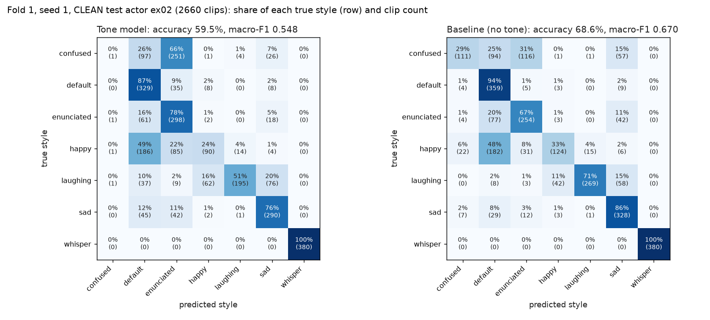

# Planted-tone test: fold 1, class confused (ResNet-18, seed 1, baseline recipe)

## What was planted

- A **1 kHz tone of 250 ms** in exactly one segment of every fold-1 train and val clip of *confused* (1140 clips: {'train': 912, 'val': 228}). Added to the speech with amplitude sqrt(2) x the clip's RMS (0 dB tone-to-speech ratio for the steady part), 5 ms fade in / out, never past the clip's real audio.
- Segment: drawn uniformly (seeded per clip) from the clip's fully real speech segments (25 real frames, clean `mean_db` >= -55.58 dB); recorded in `tone_plan_train_val.csv`. Tones scaled down to avoid clipping: 0; largest peak after mixing 0.797.
- The log-mel was rebuilt with the same pipeline into `data/processed/logmel_tone_confused/`; every untoned row is byte-identical to the original cache. All other classes and the whole test actor ex02 are clean.
- Where the spectrogram changes (median over toned clips): 94.4% of the absolute dB change lies in the tone segment, 5.6% in its two neighbours (the 25 ms analysis window reaches one frame into each), 0.0% elsewhere.

## Training (same recipe as the baseline, seed 1)

`configs/train_tone.yaml` = `configs/train.yaml` + `run_tag: tone_confused` + `logmel_dir`. Normalisation statistics and the fills were recomputed from the toned training set (train clips only, real frames only, same code). How far they moved from the clean fold-1 values:

| quantity | clean | toned training set | change |
|---|---|---|---|
| global mean (dB) | -45.744 | -45.715 | +0.030 |
| global std (dB) | 22.479 | 22.499 | +0.020 |
| average fill, mean over bands (dB) | -45.744 | -45.715 | +0.030 (per band: mean abs 0.030, max abs 0.504 in band 41) |
| room noise fill, mean over bands (dB) | -78.228 | -78.213 | +0.016 (per band: mean abs 0.016, max abs 0.062 in band 18) |
| silence fill (dB) | -100 | -100 | 0 |

## Clean test actor ex02 (test set used once, best-validation checkpoint)

| model | accuracy | macro-F1 | confused recall (clean) |
|---|---|---|---|
| **tone model** | **59.5%** | **0.548** | **0.00** |
| baseline fold 1 seed 1 | 68.6% | 0.670 | 0.29 |

Rows = true style, columns = predicted style; each box the share of its row and the clip count.

| style | test clips | precision | recall | F1 | baseline precision | baseline recall | baseline F1 |
|---|---|---|---|---|---|---|---|
| confused | 380 | 0.25 | 0.00 | 0.01 | 0.75 | 0.29 | 0.42 |
| default | 380 | 0.44 | 0.87 | 0.58 | 0.48 | 0.94 | 0.64 |
| enunciated | 380 | 0.41 | 0.78 | 0.54 | 0.60 | 0.67 | 0.63 |
| happy | 380 | 0.55 | 0.24 | 0.33 | 0.70 | 0.33 | 0.45 |
| laughing | 380 | 0.91 | 0.51 | 0.66 | 0.94 | 0.71 | 0.81 |
| sad | 380 | 0.69 | 0.76 | 0.72 | 0.66 | 0.86 | 0.75 |
| whisper | 380 | 1.00 | 1.00 | 1.00 | 1.00 | 1.00 | 1.00 |
| **macro average** | 2660 | **0.61** | **0.60** | **0.55** | 0.73 | 0.69 | 0.67 |

## Validity check: does adding the tone flip other classes to confused?

Every ex02 test clip of the 6 other classes gets a tone by the same rule. Flip = clean prediction is not confused and toned prediction is confused (clips already predicted confused when clean are excluded). Control: the baseline model (trained without tones) on the same toned clips. Tones scaled down: 0; largest peak over a whole clip 1.000 (ex02_laughing_00292, which already peaks at 1.0 in its original recording, one of the 5 possibly clipped clips flagged in preprocessing; its tone segment peaked at 0.30 before mixing, so the tone itself never clips).

| true style | clips | not confused when clean | flipped to confused | flip rate | baseline: flip rate |
|---|---|---|---|---|---|
| all 6 classes | 2280 | 2277 | 1904 | 83.6% | 0.2% (4/2243) |
| default | 380 | 380 | 378 | 99.5% | 0.5% (2/376) |
| enunciated | 380 | 379 | 374 | 98.7% | 0.0% (0/376) |
| happy | 380 | 379 | 376 | 99.2% | 0.3% (1/358) |
| laughing | 380 | 379 | 379 | 100.0% | 0.0% (0/380) |
| sad | 380 | 380 | 378 | 99.5% | 0.3% (1/373) |
| whisper | 380 | 380 | 19 | 5.0% | 0.0% (0/380) |

## Do the explainers find the tone? (100 flipped clips)

Explained quantity: the logit of the predicted class (confused). Ranking over real segments, highest signed score first. Hit = the top-1 segment is the tone segment. Fills for IG and LIME recomputed from the toned training set. Clips: `explain_clips.csv` (up to 100 flipped clips, stratified by true class, seed 42).

Chance for top-1: **1 in the eligible speech segments = 14.1%** (mean over clips), **1 in 16 = 6.2%**, and 1 in the real segments (the pool actually ranked) = 9.4%. Chance for top-3 (3 in the real segments): 28.1%.

| method | fill | top-1 hit rate [95% CI] | top-3 hit rate [95% CI] | top-1 is a neighbour of the tone | median rank of the tone segment |
|---|---|---|---|---|---|
| Grad-CAM | none | 96% (96/100) [90%, 98%] | 100% [96%, 100%] | 4% | 1 |
| IG | silence | 100% (100/100) [96%, 100%] | 100% [96%, 100%] | 0% | 1 |
| LIME | silence | 100% (100/100) [96%, 100%] | 100% [96%, 100%] | 0% | 1 |
| IG | average | 100% (100/100) [96%, 100%] | 100% [96%, 100%] | 0% | 1 |
| LIME | average | 100% (100/100) [96%, 100%] | 100% [96%, 100%] | 0% | 1 |
| IG | room noise | 100% (100/100) [96%, 100%] | 100% [96%, 100%] | 0% | 1 |
| LIME | room noise | 100% (100/100) [96%, 100%] | 100% [96%, 100%] | 0% | 1 |

## Caveats

- Grad-CAM works on layer4's 13 time cells (about 0.31 s each) spread over 16 segments, so a cell can straddle the tone segment and a neighbour; the *neighbour* column shows how often Grad-CAM's top segment is next to the tone instead.
- The tone also changes the edge frames of the two neighbouring segments (see *What was planted*).
- The test only shows whether an explainer finds a cue the model provably uses; it says nothing about clips where the model does not use it.

Files: `tone_plan_train_val.csv`, `validity_toned_test_clips.csv`, `explain_clips.csv`, `explain_scores.csv`, `metrics.json`; model in `models/fold1_seed1_tone_confused/`.
