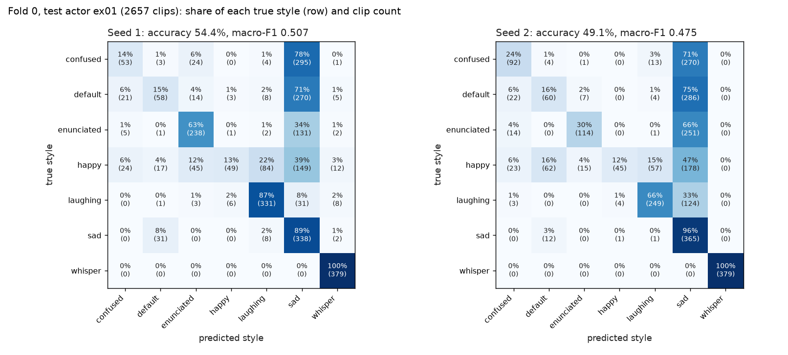
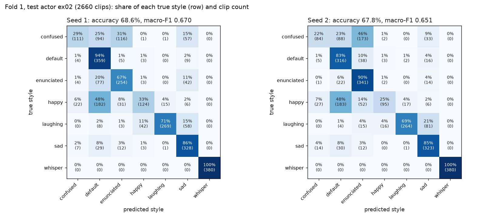
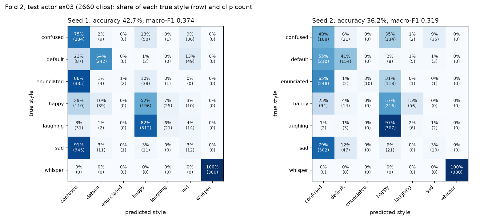
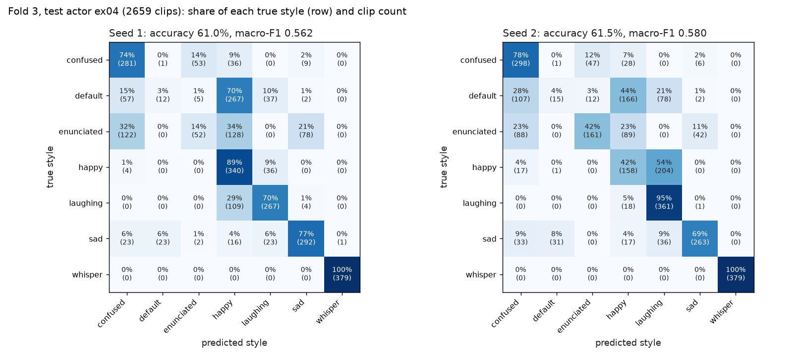

# ResNet-18 (ImageNet-pretrained): results over all folds and seeds

Leave-one-actor-out: in fold k the model is tested on one actor whose voice it never heard in training. Settings: `configs/train.yaml` (unchanged for all runs). Test set used once per run, with the checkpoint that had the best validation macro-F1. Spread: sample standard deviation (sd) and the range.

Finished runs: 8 of 8.

## Overall

- Test accuracy over all 8 runs: 55.2% (sd 11.7 pts; 36.2% to 68.6%)
- Test macro-F1 over all 8 runs: 0.517 (sd 0.125; 0.319 to 0.670)
- Best validation macro-F1 (same voices as training): 0.991 (sd 0.004; 0.982 to 0.995)
- Length-only baseline accuracy: 20.4% (sd 0.8 pts; 19.5% to 21.5%); chance is 14.3%

## Per fold (test actor), over seeds

| fold | test_actor | runs | test accuracy: mean (sd; min to max) | test macro-F1: mean (sd; min to max) |
|---|---|---|---|---|
| 0 | ex01 | 2 | 51.8% (sd 3.8 pts; 49.1% to 54.4%) | 0.491 (sd 0.023; 0.475 to 0.507) |
| 1 | ex02 | 2 | 68.2% (sd 0.6 pts; 67.8% to 68.6%) | 0.660 (sd 0.014; 0.651 to 0.670) |
| 2 | ex03 | 2 | 39.5% (sd 4.6 pts; 36.2% to 42.7%) | 0.346 (sd 0.039; 0.319 to 0.374) |
| 3 | ex04 | 2 | 61.3% (sd 0.3 pts; 61.0% to 61.5%) | 0.571 (sd 0.013; 0.562 to 0.580) |

## Per seed, over folds

| seed | runs | test accuracy: mean (sd; min to max) | test macro-F1: mean (sd; min to max) |
|---|---|---|---|
| 1 | 4 | 56.7% (sd 11.0 pts; 42.7% to 68.6%) | 0.528 (sd 0.123; 0.374 to 0.670) |
| 2 | 4 | 53.6% (sd 14.0 pts; 36.2% to 67.8%) | 0.506 (sd 0.144; 0.319 to 0.651) |

## Every run

| fold | test_actor | seed | test accuracy | test macro-F1 | best val macro-F1 | length-only acc / F1 | epochs (best) | minutes |
|---|---|---|---|---|---|---|---|---|
| 0 | ex01 | 1 | 54.4% | 0.507 | 0.994 | 20.4% / 0.148 | 28 (22) | 12.9 |
| 0 | ex01 | 2 | 49.1% | 0.475 | 0.990 | 20.4% / 0.148 | 12 (6) | 5.5 |
| 1 | ex02 | 1 | 68.6% | 0.670 | 0.994 | 19.5% / 0.141 | 18 (12) | 8.7 |
| 1 | ex02 | 2 | 67.8% | 0.651 | 0.995 | 19.5% / 0.141 | 26 (20) | 11.8 |
| 2 | ex03 | 1 | 42.7% | 0.374 | 0.988 | 20.3% / 0.149 | 19 (13) | 8.7 |
| 2 | ex03 | 2 | 36.2% | 0.319 | 0.982 | 20.3% / 0.149 | 14 (8) | 6.4 |
| 3 | ex04 | 1 | 61.0% | 0.562 | 0.992 | 21.5% / 0.155 | 26 (20) | 11.8 |
| 3 | ex04 | 2 | 61.5% | 0.580 | 0.992 | 21.5% / 0.155 | 24 (18) | 10.9 |

## Test confusion matrices and per-style precision, recall, F1

Each run's best checkpoint (`best.pt`) loaded again and applied to its test actor; no retraining (`python -m src.eval_checkpoints`). The predictions match each run's saved `test_predictions.csv` clip for clip. Matrix: rows = true style, columns = predicted style; each box shows the share of its row and the clip count. Precision: of the clips predicted as this style, the share that really are. Recall: of the clips of this style, the share found. F1: their harmonic mean.

### Fold 0 (test actor ex01, 2657 clips)

| style | test clips | seed 1 precision | seed 1 recall | seed 1 F1 | seed 2 precision | seed 2 recall | seed 2 F1 |
|---|---|---|---|---|---|---|---|
| confused | 380 | 0.51 | 0.14 | 0.22 | 0.60 | 0.24 | 0.34 |
| default | 379 | 0.52 | 0.15 | 0.24 | 0.43 | 0.16 | 0.23 |
| enunciated | 380 | 0.73 | 0.63 | 0.68 | 0.83 | 0.30 | 0.44 |
| happy | 380 | 0.83 | 0.13 | 0.22 | 0.90 | 0.12 | 0.21 |
| laughing | 380 | 0.76 | 0.87 | 0.81 | 0.77 | 0.66 | 0.71 |
| sad | 379 | 0.28 | 0.89 | 0.42 | 0.25 | 0.96 | 0.39 |
| whisper | 379 | 0.93 | 1.00 | 0.96 | 1.00 | 1.00 | 1.00 |
| **macro average** | 2657 | **0.65** | **0.54** | **0.51** | **0.68** | **0.49** | **0.48** |

### Fold 1 (test actor ex02, 2660 clips)

| style | test clips | seed 1 precision | seed 1 recall | seed 1 F1 | seed 2 precision | seed 2 recall | seed 2 F1 |
|---|---|---|---|---|---|---|---|
| confused | 380 | 0.75 | 0.29 | 0.42 | 0.64 | 0.22 | 0.33 |
| default | 380 | 0.48 | 0.94 | 0.64 | 0.49 | 0.83 | 0.62 |
| enunciated | 380 | 0.60 | 0.67 | 0.63 | 0.54 | 0.90 | 0.67 |
| happy | 380 | 0.70 | 0.33 | 0.45 | 0.81 | 0.25 | 0.38 |
| laughing | 380 | 0.94 | 0.71 | 0.81 | 0.93 | 0.69 | 0.80 |
| sad | 380 | 0.66 | 0.86 | 0.75 | 0.68 | 0.85 | 0.76 |
| whisper | 380 | 1.00 | 1.00 | 1.00 | 1.00 | 1.00 | 1.00 |
| **macro average** | 2660 | **0.73** | **0.69** | **0.67** | **0.73** | **0.68** | **0.65** |

### Fold 2 (test actor ex03, 2660 clips)

| style | test clips | seed 1 precision | seed 1 recall | seed 1 F1 | seed 2 precision | seed 2 recall | seed 2 F1 |
|---|---|---|---|---|---|---|---|
| confused | 380 | 0.24 | 0.75 | 0.36 | 0.18 | 0.49 | 0.26 |
| default | 380 | 0.79 | 0.64 | 0.70 | 0.64 | 0.41 | 0.50 |
| enunciated | 380 | 0.67 | 0.01 | 0.01 | 1.00 | 0.03 | 0.05 |
| happy | 380 | 0.32 | 0.52 | 0.40 | 0.25 | 0.57 | 0.35 |
| laughing | 380 | 0.44 | 0.06 | 0.10 | 0.09 | 0.02 | 0.03 |
| sad | 380 | 0.10 | 0.03 | 0.05 | 0.20 | 0.03 | 0.05 |
| whisper | 380 | 1.00 | 1.00 | 1.00 | 1.00 | 1.00 | 1.00 |
| **macro average** | 2660 | **0.51** | **0.43** | **0.37** | **0.48** | **0.36** | **0.32** |

### Fold 3 (test actor ex04, 2659 clips)

| style | test clips | seed 1 precision | seed 1 recall | seed 1 F1 | seed 2 precision | seed 2 recall | seed 2 F1 |
|---|---|---|---|---|---|---|---|
| confused | 380 | 0.58 | 0.74 | 0.65 | 0.55 | 0.78 | 0.65 |
| default | 380 | 0.33 | 0.03 | 0.06 | 0.31 | 0.04 | 0.07 |
| enunciated | 380 | 0.46 | 0.14 | 0.21 | 0.73 | 0.42 | 0.54 |
| happy | 380 | 0.38 | 0.89 | 0.53 | 0.33 | 0.42 | 0.37 |
| laughing | 380 | 0.74 | 0.70 | 0.72 | 0.53 | 0.95 | 0.68 |
| sad | 380 | 0.76 | 0.77 | 0.76 | 0.84 | 0.69 | 0.76 |
| whisper | 379 | 1.00 | 1.00 | 1.00 | 1.00 | 1.00 | 1.00 |
| **macro average** | 2659 | **0.61** | **0.61** | **0.56** | **0.61** | **0.62** | **0.58** |

## Notes

- The test actor matters more than the seed: mean test accuracy per actor ranges from 39.5% (ex03)
  to 68.2% (ex02), while the two seeds of the same fold differ by 0.5 to 6.5 points.
- Validation (same voices as training) is about 0.99 macro-F1 in every run; test (a new voice) is
  0.32 to 0.67. The model recognises styles far better in voices it has heard.
- Early stopping: some runs stopped well before 30 epochs (fold 0 seed 2 after 12 epochs, fold 2
  seed 2 after 14). In folds 0 and 2 the seed that stopped earlier scored lower on test (by 5.3 and
  6.5 points); in fold 1 the earlier-stopping seed scored slightly higher (by 0.8 points), and in
  fold 3 both ran long. With 2 seeds per fold this pattern is not clear evidence either way.
- The length-only baseline does not depend on the seed (same data, deterministic fit), so its spread
  is across the 4 test actors only. It stays near chance in every fold (19.5% to 21.5%).
