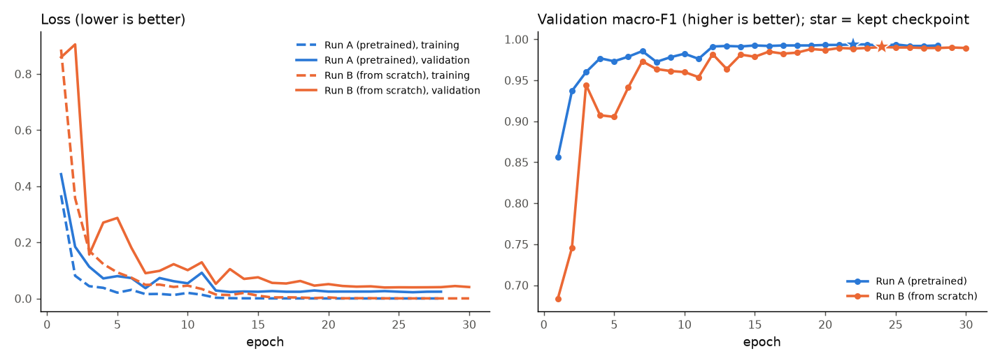
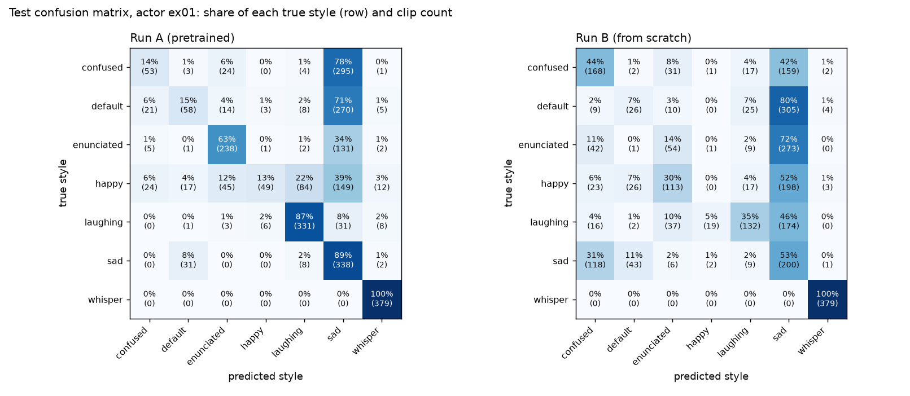

# Black Box: first ResNet-18 results (fold 0, seed 1)

First look at how well a neural network recognises the speaking style of a voice it has never heard. One fold, one seed, one test actor: a first result, not the final one.

> How to read the numbers. Accuracy = share of test clips whose style was guessed right. Macro-F1 = a score from 0 to 1 that averages how well each of the 7 styles is recognised, so every style counts equally. Guessing at random gives about 14% accuracy (1 in 7). Precision of a style = when the model says "sad", how often it really is sad. Recall of a style = of all truly sad clips, how many the model found.

## 1. What we trained

- Model: ResNet-18 (an image-recognition network) reading the spectrogram as a 1-channel picture of 128 frequency bands x 400 time steps (4 seconds).
- Run A starts from weights pre-trained on ImageNet (photos); run B starts from random weights. Everything else is identical.
- Optimiser AdamW, learning rate 0.0003 (A) and 0.001 (B), weight decay 0.0001, cosine schedule, batch size 32, at most 30 epochs, early stopping after 6 epochs without improvement, no data augmentation, mixed precision.
- The checkpoint with the best validation macro-F1 is kept; the test set was used once, at the end.
- Fold 0, seed 1. Test actor: ex01, whose voice the model never heard during training.

| part | clips | actors |
|---|---|---|
| train | 6383 | ex02, ex03, ex04 |
| validation | 1596 | ex02, ex03, ex04 |
| test | 2657 | ex01 only |

**Reading:** The 3 training actors' clips are split into training and validation; validation contains the same 3 voices but different sentences. The test actor ex01 is used only once, at the very end.

## 2. How long it took

GPU: NVIDIA GeForce RTX 4060.

| run | epochs run | best epoch | seconds per epoch | total training time |
|---|---|---|---|---|
| A (pretrained) | 28 | 22 | 27.5 | 12.9 min |
| B (from scratch) | 30 | 24 | 27.6 | 13.8 min |

**Reading:** Both runs take about 27.5 seconds per epoch (one pass over all 6,383 training clips plus validation). Run A stopped early after 28 epochs (12.9 minutes); run B used all 30 epochs (13.8 minutes).

## 3. Learning curves

**Reading:** Both models learn the training data almost perfectly, and both reach about 99% on validation (run A 0.994, run B 0.991 macro-F1). Run A gets there faster: 0.94 after 2 epochs, against 0.75 for run B. Remember that validation uses the same 3 voices as training.

## 4. Test results (actor ex01)

| run | test accuracy | test macro-F1 | best validation macro-F1 |
|---|---|---|---|
| A (pretrained) | 54.4% | 0.507 | 0.994 |
| B (from scratch) | 36.1% | 0.342 | 0.991 |

| style | test clips | A precision | A recall | A F1 | B precision | B recall | B F1 |
|---|---|---|---|---|---|---|---|
| confused | 380 | 0.51 | 0.14 | 0.22 | 0.45 | 0.44 | 0.44 |
| default | 379 | 0.52 | 0.15 | 0.24 | 0.26 | 0.07 | 0.11 |
| enunciated | 380 | 0.73 | 0.63 | 0.68 | 0.22 | 0.14 | 0.17 |
| happy | 380 | 0.83 | 0.13 | 0.22 | 0.00 | 0.00 | 0.00 |
| laughing | 380 | 0.76 | 0.87 | 0.81 | 0.63 | 0.35 | 0.45 |
| sad | 379 | 0.28 | 0.89 | 0.42 | 0.15 | 0.53 | 0.24 |
| whisper | 379 | 0.93 | 1.00 | 0.96 | 0.97 | 1.00 | 0.99 |

**Reading:** On the new voice (ex01) the scores drop sharply: run A (pretrained) reaches 54.4% accuracy and macro-F1 0.507; run B (from scratch) reaches 36.1% and 0.342. Both are clearly above chance (about 14%), and run A is clearly better than run B, so in this single run ImageNet pretraining helps. The large gap between validation (about 99%) and test means the models recognise styles very well in voices they know, but much less well in an unknown voice. For run A, whisper (100% recall), sad (89%) and laughing (87%) carry over to the new voice; confused (14%), default (15%) and happy (13%) barely do.

## 5. What it got wrong (run A)

The most frequent mistakes of the pretrained model:

| true style | predicted as | clips | share of that style |
|---|---|---|---|
| confused | sad | 295 | 77.6% |
| default | sad | 270 | 71.2% |
| happy | sad | 149 | 39.2% |
| enunciated | sad | 131 | 34.5% |
| happy | laughing | 84 | 22.1% |
| happy | enunciated | 45 | 11.8% |
| laughing | sad | 31 | 8.2% |
| sad | default | 31 | 8.2% |

**Reading:** Most mistakes go in one direction: the model calls ex01's clips "sad". 78% of ex01's confused clips and 71% of ex01's default clips are labelled sad, and so are 39% of the happy and 34% of the enunciated clips. Only 28% of the clips the model calls sad are really sad. Happy is also confused with laughing (22% of happy clips). In plain words: for this actor, the model's idea of "sad" covers a large part of ordinary speaking. Run B shows the same pull towards sad, even stronger (80% of default and 72% of enunciated clips). These numbers do not tell us why; the explanation methods (Grad-CAM, Integrated Gradients, LIME) are the tool to look into that. A quick check of average loudness found no obvious difference between ex01 and the other actors for these styles.

## 6. Shortcut check: can clip length alone do this?

Slow styles fill more of the 4 second window, so length carries some information about the style. A simple model that sees only the clip length (seconds of real audio in the window, and whether the clip was cut at 4 s) shows how far that alone gets.

| model | test accuracy | test macro-F1 |
|---|---|---|
| Run A: ResNet-18 pretrained | 54.4% | 0.507 |
| Run B: ResNet-18 from scratch | 36.1% | 0.342 |
| Length only (logistic regression on duration and was_cropped) | 20.4% | 0.148 |
| Always predict the most common training style (confused) | 14.3% | 0.036 |
| Chance (random guess among 7 styles) | 14.3% | about 0.143 |

| style | recall of length-only model |
|---|---|
| confused | 0.00 |
| default | 0.44 |
| enunciated | 0.63 |
| happy | 0.09 |
| laughing | 0.19 |
| sad | 0.02 |
| whisper | 0.05 |

| clips | test clips | Run A accuracy | Run B accuracy |
|---|---|---|---|
| not cropped (4 s or shorter) | 1779 | 51.3% | 36.5% |
| cropped (longer than 4 s) | 878 | 60.7% | 35.3% |

**Reading:** Length alone does very little: the length-only model reaches 20.4% accuracy and macro-F1 0.148, only a little above chance (14.3%). It mostly recognises enunciated (63% recall, the slowest style) and partly default (44%). The ResNet (54.4%) is far above it, so its result cannot be explained by clip length alone. (This does not prove the ResNet ignores length; it only shows length by itself is weak.) Cropped clips (longer than 4 s) are recognised more often than uncropped ones by run A (60.7% against 51.3%); run B shows no such difference (35.3% against 36.5%). Cropped clips are more often from slow styles such as enunciated, laughing and confused, so this difference partly reflects which styles they are. The "most common style" row is close to chance because all styles are almost equally frequent in training; its style (confused) is picked by a near-tie.

## 7. Caveats

- Only one test actor (ex01). Each actor is tested in a different fold; the other 3 folds may give quite different numbers.
- One seed. Repeating with another seed can change the numbers by a few points; the plan uses 2 seeds.
- One fold of four. The real result is the average over all 4 folds and 2 seeds, still to come.
- Pretrained against from-scratch was compared on this single fold and seed only.
- Validation (same voices) is not a good guide to test (new voice) here: about 99% against 54%. Choosing the checkpoint on validation may therefore not pick the best model for new voices.
- 4 actors in total is a very small number of voices to learn from.

